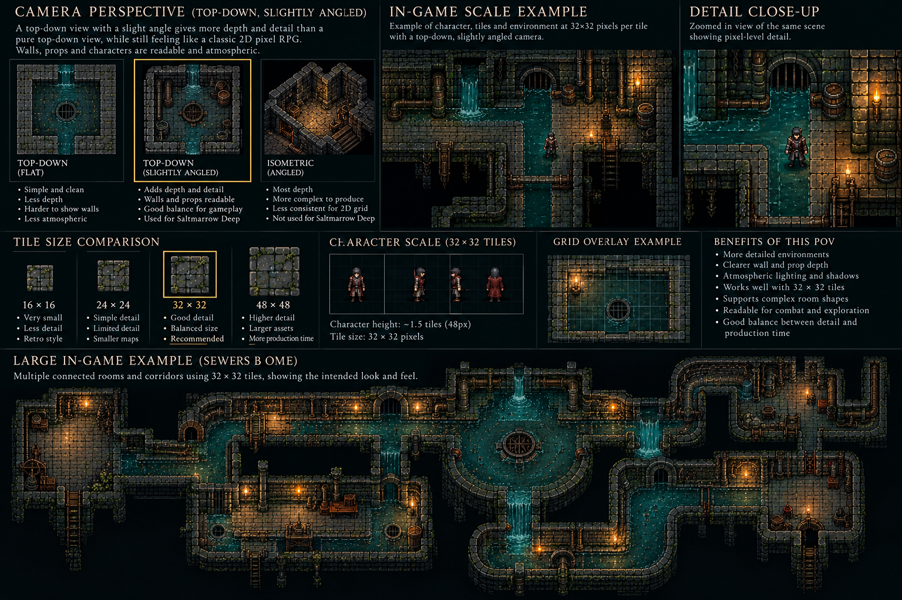

# Dungeon visual references

## camera-perspective-concept.png

Concept illustration supplied by the user on 28 October 2026 as the approved camera-perspective reference from the Saltmarrow Overhaul Plan conversation. The earlier chat retrieval exposed no image attachment; this copy comes from the user’s attachment in the continuation chat.

Use the highlighted slightly angled top-down example for perspective, visible wall faces, mood and relative scale. The flat top-down and isometric panels are comparisons, not alternative approved cameras. This is a flattened concept board with captions and illustrative grids, not a game-ready sprite sheet, pixel-accurate tile atlas, playable scene or proof of engine implementation. Do not crop it into production tiles or derive collision from it.

The board labels a 32 × 32px tile and an approximate 48px-tall character. The former is the base tile resolution; the latter is an illustrative visible-body scale, not a replacement for ART_JOBS’ 64 × 64px character frame and feet at x32/y56. Larger sprites may span multiple tiles without changing the base grid. Production proportions must be checked together with doorways and props.

File format: PNG; dimensions: 1536 × 1024px; one static opaque concept board. Animation rows, frame counts, sprite anchors and facing directions: not applicable. Text and presentation styling in this reference are not permitted in production sprite exports. See the [approved dungeon visual standard](../saltmarrow-deep-biome-layout-guide.md#approved-dungeon-visual-art-standard) for production requirements.
