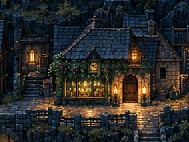

# Apothecary — legacy reference only

- `legacy-thorn-crop.webp`: original crop from the web game's `assets/town-v6/sites/apothecary.webp`.
- `legacy-thorn-crop.png`: PNG conversion of that same image, without resizing, smoothing or background removal.

One still frame, no animation rows or facing directions. Dimensions are in the inventory. This includes surrounding masonry, street and neighbouring structures; it is opaque and is not an isolated transparent building sprite. It is not verified as the separate apothecary concept image requested from the chat. That image remains missing.

The older town notes call it Thorn Apothecary and describe herb-lit frontage. Its older service-unlock story is not adopted as new Godot canon by this migration.
