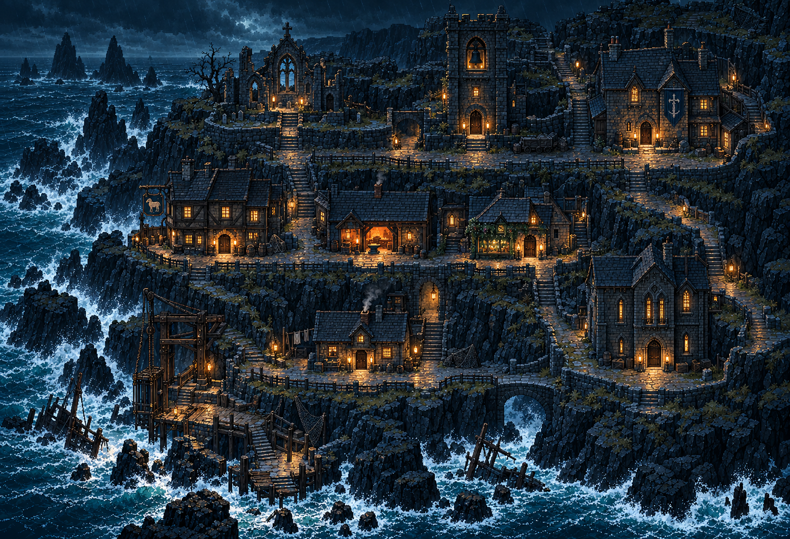

# Town hub references

| File | Role |
| --- | --- |
| `town-style-reference.png` | Exact local reference from `outputs/biome-reset-mockups/`; used by the saved town-led biome prompts. |
| `legacy-town-v6-master.png` | Exact older web-game town master; not verified as the latest conversation reference. |
| `legacy-generation-prompt.txt` | Verbatim saved prompt for the older v6 master. |

These are complete opaque still compositions, not animation sheets: one image/frame each, no animation rows, no facing directions. See the inventory for native dimensions. The legacy town was authored around a 32px square movement grid; its master image is not a directly registered Godot tilemap.

The older source notes describe a cliff settlement with Deep Bell Tower, Saint Hollis chapel, Town Hall, Drowned Lamb, smithy, Thorn Apothecary, Old Archive, player cottage and wharf lift. Those notes also describe older NPC/service progression; they do not establish the new Godot story canon. The present Godot README and recovered future story bible take precedence when deciding new content.
