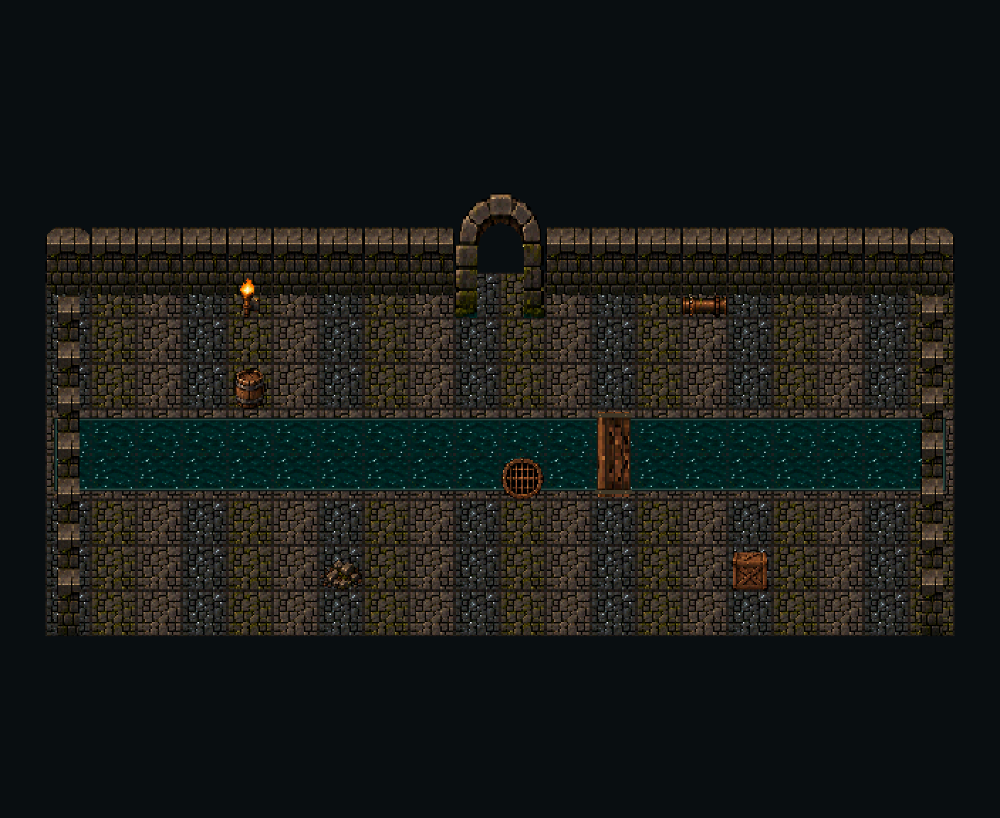

# Sewer Tileset v1.0 — minimum viable art pack

Review candidate, 28 October 2026. **68 exported assets**, on a 32 × 32px orthogonal grid. This is a new asset pack guided by the supplied Sewer Tileset v0.2 concept, not a pixel-accurate conversion of that illustration. It is ready for art review and manual Godot setup; engine import, gameplay collision and scale approval are still pending.

## Contents and sheet layouts

| File/group | Canvas/frame | Layout and count | Facing |
| --- | --- | --- | --- |
| `terrain_atlas.png` | 256 × 224; 32 × 32 regions | 8 columns, 7 rows; 55 occupied cells, final cell blank | Fixed overhead; do not rotate textures |
| `sprite_atlas.png` | 256 × 384; 64 × 96 storage cells | 4 columns, 4 rows; 13 occupied cells, 3 blank | See sprite list below |
| `tiles/floor_*.png` | 32 × 32 | Dry, wet, moss, mud; four separate static variations | Fixed |
| `tiles/water_0..3.png` | 32 × 32 | Four separate static variations, **not animation frames** | Fixed |
| `tiles/bank_*.png` | 32 × 32 | Complete 47-mask shoreline set; includes `bank_00` water-only | Fixed |
| `sprites/wall_n.png` | 32 × 64 | One static south-facing wall, cap and face | South |
| `sprites/wall_side.png` | 32 × 64 | One static vertical map-axis wall | North–south run |
| `sprites/wall_curve_e/w.png` | 32 × 64 each | Two mirrored rounded wall ends | South-facing, E/W ends |
| `sprites/arch.png` | 64 × 96 | One static open doorway; clear alpha aperture | South |
| `sprites/drain.png`, `pipe_h.png`, `barrel.png`, `crate.png`, `rubble.png`, `torch.png` | 32 × 32 each | One static sprite per file | Fixed overhead; pipe east–west |
| `sprites/bridge_h.png` | 64 × 32 | One static two-cell maintenance crossing | East–west |
| `sprites/bridge_v.png` | 32 × 64 | One static two-cell maintenance crossing | North–south |
| `previews/*.png` | 704 × 576 native; 1408 × 1152 at 2× | Corridor, cross junction, stepped cistern, each assembled from exports | Fixed |

No image contains labels or grid lines. Every exported gameplay image is RGBA with alpha restricted to 0/255; terrain is intentionally opaque. There are no animation sheets in this MVP. Atlas cells are not animation frames. All atlas positions, exact regions, per-file anchors, footprint dimensions, collision suggestions and SHA-256 hashes are in [manifest.json](manifest.json). Export-only test results are in [validation.json](validation.json), with procedure and limitations in [QA.md](QA.md).

## Placement and origins

Coordinates are pixel boundaries from the image top left, +x right, +y down. Terrain origin is (16,16). Sprite origins are bottom centre of their actual canvases: (16,32) for small props, (16,64) for walls/vertical bridge, (32,96) for the arch and (32,32) for the horizontal bridge. Place a one-cell sprite's origin at the bottom centre of its ground cell. A wall's extra height extends upward; it does not occupy two walkable cells. The arch occupies a two-cell-wide, one-cell-deep ground footprint, with visual overhang above it. Bridges occupy two adjacent ground cells. Visible dimensions and footprints are deliberately separate.

`sprite_atlas.png` stores every sprite at the **top left** of a 64 × 96 cell. Use each manifest `atlas_region_px`, rather than treating the entire storage cell as the sprite. No gaps, margins or packed rotations are present. Single-file sprites are the simplest way to preserve their anchors.

For a centred Sprite2D using the exact region, offset = half the actual canvas size minus `origin_px`. Convert suggested collision points to node-local coordinates by subtracting `origin_px`. All supplied collision polygons are suggestions, in source-image top-left coordinates; no collision or navigation resources are installed. Wall suggestions occupy the bottom 32px ground footprint; arch suggestions cover the two piers and leave the centre open. Drain, pipe, rubble and torch are decorative by default. Barrel/crate blocking is optional. Water depth, drowning, movement costs and hazard rules must be assigned by the code owner. Bank lips are visual edging, not extra navigable cells. Bridge cells may be walkable above otherwise blocked water.

## Bank selection

Each `bank_XX` is a **water cell** surrounded by dry neighbours as indicated by the hexadecimal mask. Bit order: N=1, E=2, S=4, W=8, NE=16, SE=32, SW=64, NW=128. A set bit means the neighbour is dry. A diagonal bit is cleared when either of its adjacent cardinal bits is set: NE when N or E is set; similarly SE/E/S, SW/S/W, NW/W/N. That normalization produces exactly 47 distinct masks. `bank_00` is open water. Cardinal dry neighbours produce a six-pixel stone lip inside the water cell; isolated diagonal neighbours produce rounded corner nibs. The water surface used by the banks is `water_0`; the lip uses `floor_dry`. All floor variants share the same boundary profile, as do all four water variations, so these can meet the bank set without seams.

Do not randomly choose shoreline tiles, rotate lighting, or interpret these custom mask values as Godot terrain IDs. Configure terrain peering bits manually or have Claude map this documented mask contract. The JSON plans beside the previews show actual tile IDs and sprite top-left positions, independent of any runtime API.

## Godot 4.6 handoff

The repository declares Godot 4.6 and already uses nearest filtering and transform pixel snapping. Import production PNGs as Texture2D, Lossless, without mipmaps or size reduction. Use nearest filtering and integer positions/scales. For the terrain TileSet: square shape, tile size 32 × 32, texture region 32 × 32, margin 0, separation 0; retain atlas texture padding. Keep source art and previews out of gameplay atlases. Their folders include `.gdignore` markers.

Create separate floor/water and foreground wall/prop layers. Do not rotate a wall face into a side wall. Use the supplied side sprite and review its end joins. Larger sprites can be Sprite2D/AtlasTexture regions with the manifest origin, or explicitly sized atlas tiles; automatic 32px slicing is only appropriate for the terrain sheet. Configure physics/navigation layers and peering rules deliberately. Do not derive collision from painted shadows or alpha outlines. Check doorway clearance with ART_JOBS' 64 × 64 character frame and feet at (32,56); the concept's approximate 48px visible character height does not override that standard.

Official references: [TileSets](https://docs.godotengine.org/en/stable/tutorials/2d/using_tilesets.html) and [image import](https://docs.godotengine.org/en/stable/tutorials/assets_pipeline/importing_images.html). These are setup conventions, not a claim that Godot was run here. Claude owns the scenes, scripts, project settings and integration.

## Provenance

- `source/approved-concept-v0_2.png`: original user-supplied Image 1, preserved unchanged as visual reference. It is a flattened concept board; its “game-ready” caption is not a validation result.
- `source/generated-material-sheet.png`: newly generated through the built-in image tool with the approved board as a style reference. The returned source is 1254 × 1254, despite the requested 1024 × 1024; it is not the production atlas.
- Production exports: new generated material, mechanically cropped into cells, registered with nearest-neighbour sampling, quantized to hard RGB steps, and thresholded to binary alpha. Shared edge profiles, bank masks, wall ends, open arch aperture, bridge assembly and atlases were prepared deterministically for this pack. No original concept sprites were cut out, and this is **not hand-pixel-authored art**.
- [source/PROMPT.md](source/PROMPT.md) records the generation prompt and processing recipe. Source and previews are documentary assets, not production sprites.

## Remaining before a full v1.0 release

- Art approval at native resolution; richer floor variation to reduce visible repetition; cohesive full curved wall sections, internal/external corners, foreground/south walls, and masonry junctions. Rounded end sprites are not a complete curved-tunnel kit.
- Closed/open sluices and gates, shallow/deep/flooded state transitions, waterfall/outfall, pipe elbows/T-junctions/valves, more drains, damaged masonry and props.
- Optional water animation with synchronized bank frames; the four supplied water images are static alternatives.
- Smooth large-radius circular cistern modules. This MVP cistern has a stepped square-grid footprint.
- Thirty sewer room archetypes with declared entrances, clearances and reviewed routes; dedicated biome transition modules; the five other biome libraries. Their distinctive architecture and geometry remain separate design work, not reskins of these previews.
- Godot import inspection, actual character/doorway scale review, physics and navigation setup, hazard/state logic, in-engine seam/occlusion testing, and playtesting.

The three previews are assembly examples, not completed gameplay rooms or a procedural generator. Their dry floor plus declared bridge cells form connected routes in the raster plans; prop collision, entry clearance and engine navigation are not covered by that check. ART_JOBS has no sewer-specific checkbox; no queued character job or Salt Pits job is marked complete. The explicit sewer request supplies this PR's scope, and all changes remain under `assets/`.
