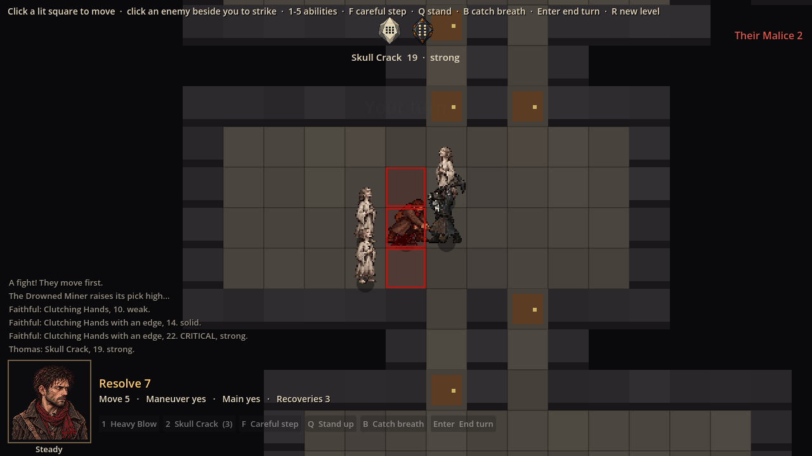
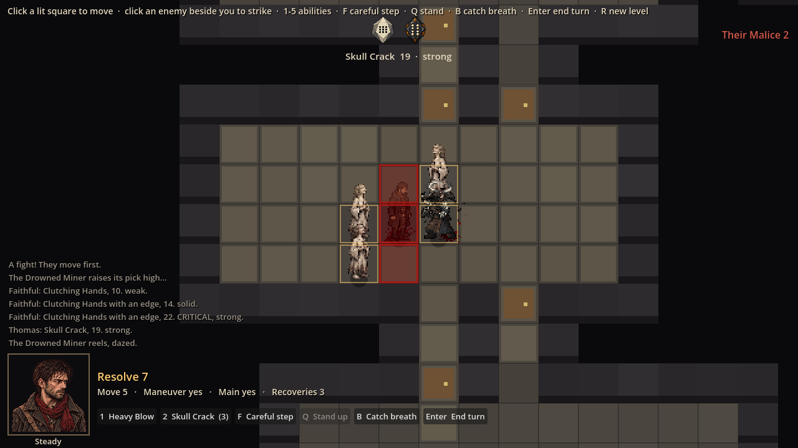
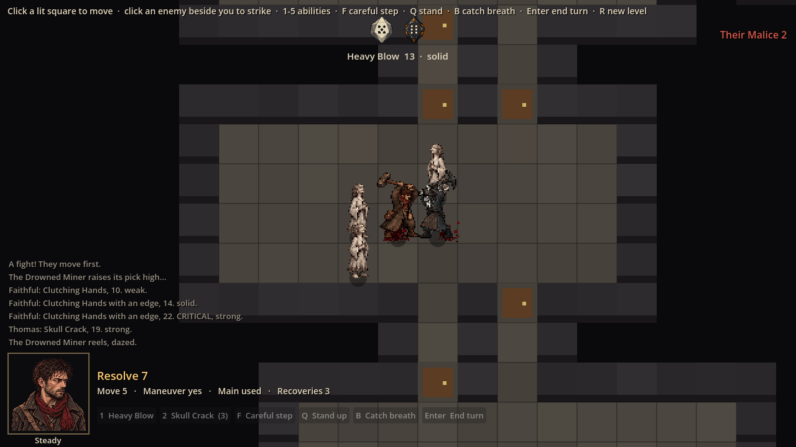
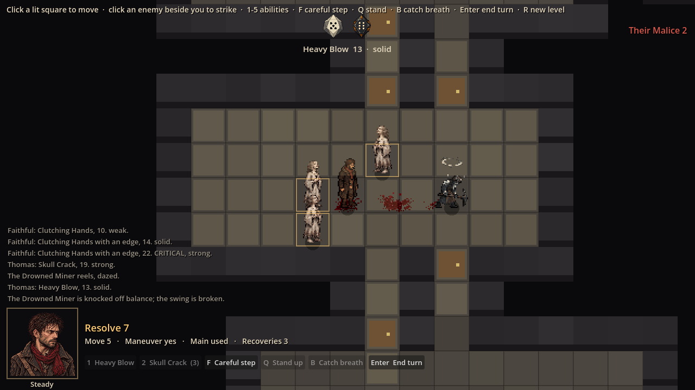

# Evidence: Thomas's mace attacks, the gore set and the dice

**Date**: 2026-10-29
**Art**: approved and merged in #9 (mace attack and abilities), #13 (blood and gore), #15 (dice).
**Engine**: Godot 4.7.2 (macOS, Compatibility renderer)
**Run result**: OBSERVED — launched windowed at 1280x720; Thomas placed beside an enemy group, then Skull Crack and Heavy Blow with fixed dice.

| Shot | What it shows |
|------|---------------|
|  | Mid Skull Crack: Thomas drawn from his ability sheet; the bone and slate dice tumbling |
|  | The roll settled: dice faces with pips; a splatter decal on the floor; the miner dazed (shimmer) |
|  | Mid Heavy Blow: wind-up, strike, recovery from the attack sheet |
|  | Afterwards: Thomas back to idle; blood decals stay on the floor |

**Wired**: Heavy Blow plays wind-up, strike and recovery (the critical overhead on a crit); each mace ability plays its own row, replacing the body as the README asks. Blood uses the pools by body size, the four splatters, the two drag smears and the four flesh chunks (small drawn drops still add spray). Each die tumbles at 12 fps, then shows its resting face for the value rolled.

**Automated**: 77 tests pass.

**Not wired yet**: the severed arm and head (the game has no dismemberment rule yet), Thomas's careful-step row (the move event doesn't say it was a careful step).
