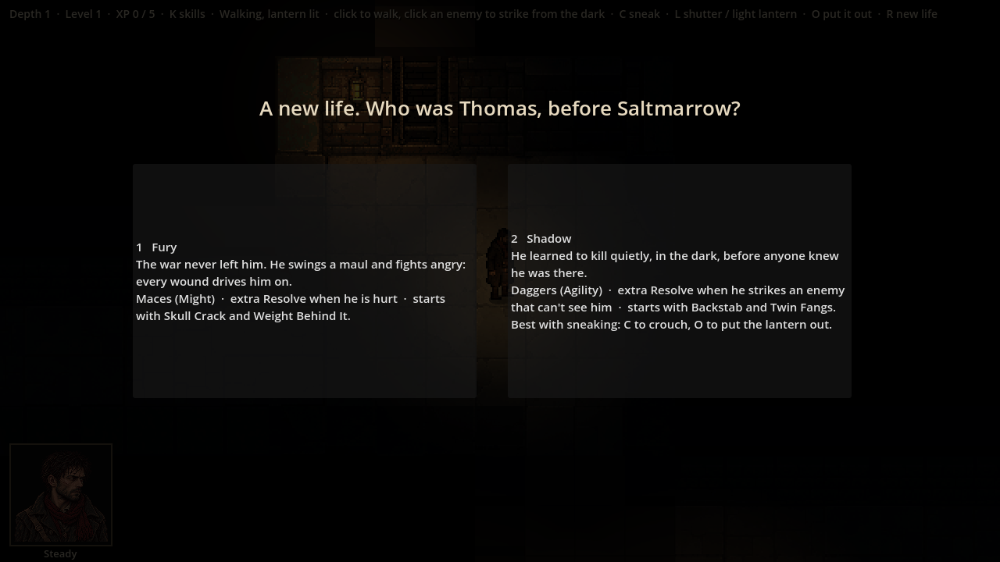
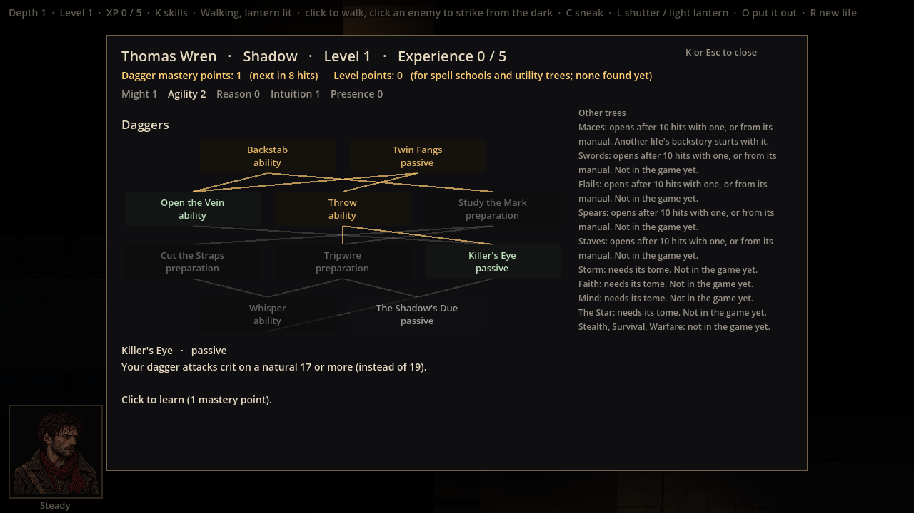
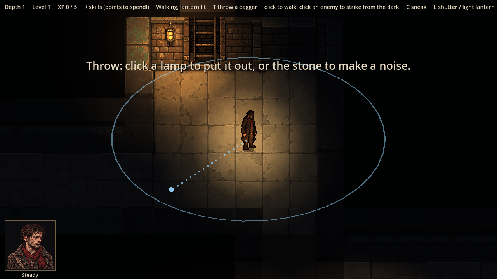

# Evidence: sneaking part 2 — choosing a backstory, the Shadow, the Daggers tree

**Date**: 2026-10-30
**Spec**: `design/quick-specs/sneaking-2026-10-30.md` (part 2); `docs/trees.md` (Daggers); `docs/story.md`
(backstories, Shadow's Resolve).
**Engine**: Godot 4.7.2 (macOS, Compatibility renderer), windowed at 1280x720, life seed 7.
**Run result**: OBSERVED — the real game driven by a capture script.

| Shot | What it shows |
|------|---------------|
|  | A new life opens with the choice (1 Fury, 2 Shadow); the game waits behind it |
|  | A Shadow's skill tree screen: Daggers, Agility lit, Backstab and Twin Fangs learned, Throw learned, Killer's Eye ready to learn; Study the Mark, Cut the Straps, Tripwire and Whisper greyed (part 3, armour) |
|  | T: ready to throw a dagger, its 7.5 m reach as a ring and a dotted line to where it would land |

**Built**
- **Choosing a backstory** at the start of each life (not on the stairs down): Fury (maces, Might, extra Resolve when
  hurt) or Shadow (daggers, Agility, extra Resolve when he strikes an enemy that can't see him, as `docs/story.md`).
- **Daggers**, rolled with Agility: Stab (basic), Backstab (only against the unaware or flanked), Twin Fangs (Stab hits
  twice, the off-hand for half), Open the Vein (heavy bleeding, 4 a turn), Throw (5 squares with a clear line),
  Killer's Eye (dagger crits on 17+), The Shadow's Due (Resolve on a crit). Dagger hits earn dagger mastery points.
- **Throw outside a fight** (T, then click): by a lamp, it puts the lamp out and the area goes dark; elsewhere it
  clatters and the nearest enemy who hears it (and only that one) comes to look.
- **The skill tree screen** shows this life's weapon tree.
- **Art**: no dagger art yet (jobs 19 and 19b moved up the list): a Shadow lunges with no blade showing.

**Checks**: 155 tests pass, including `tests/test_daggers.gd` (11 tests). Fury is unchanged.

**Not built yet** (part 3): hiding mid-fight, Study the Mark, Tripwire, Whisper; daggers lying where they were
thrown (thrown daggers are not used up yet); mastery from crits as `docs/story.md` suggests (dagger mastery comes
from hits, like maces, for now).
