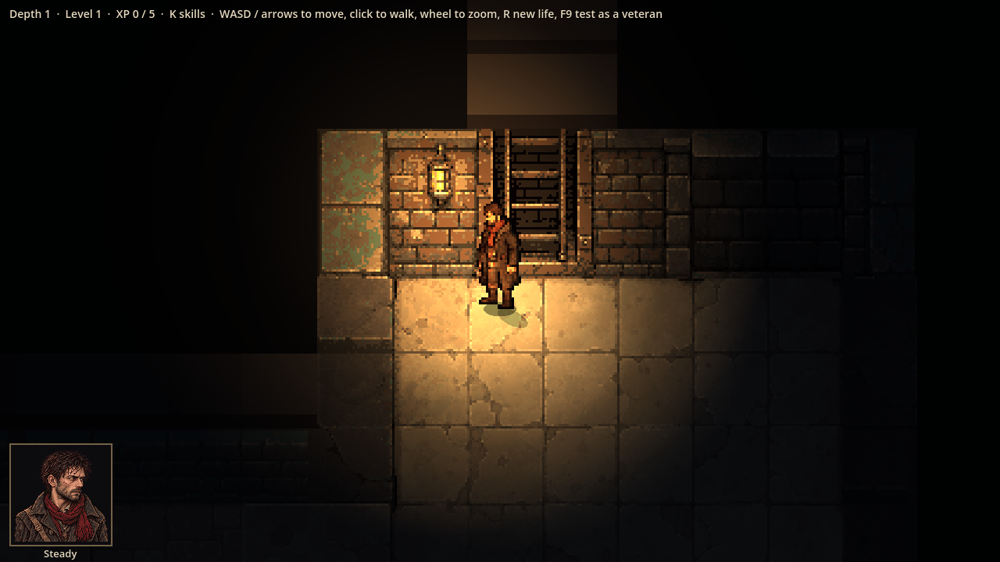
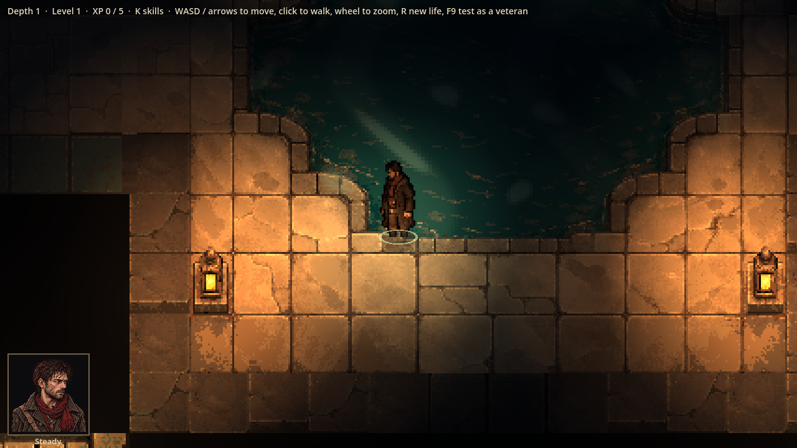
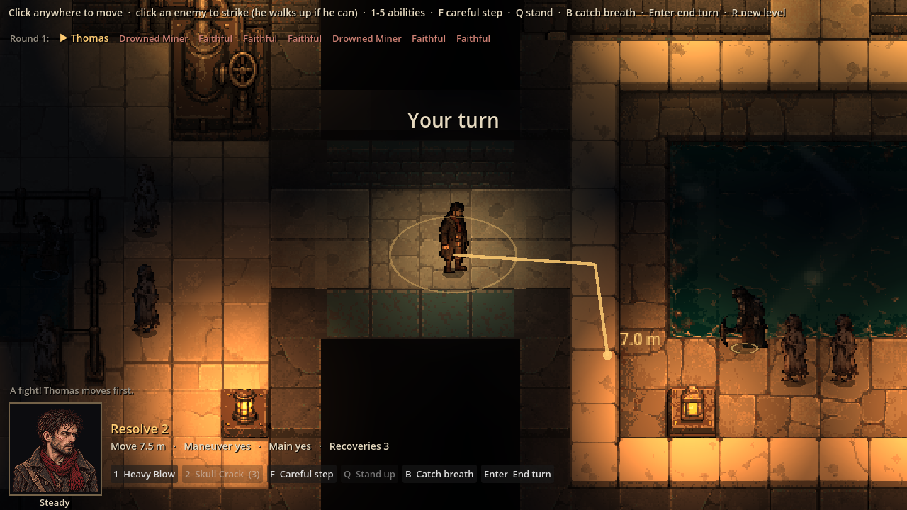
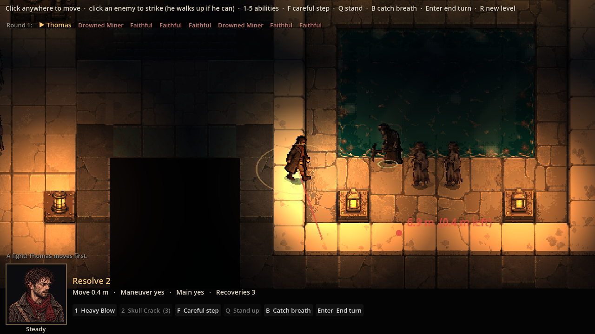
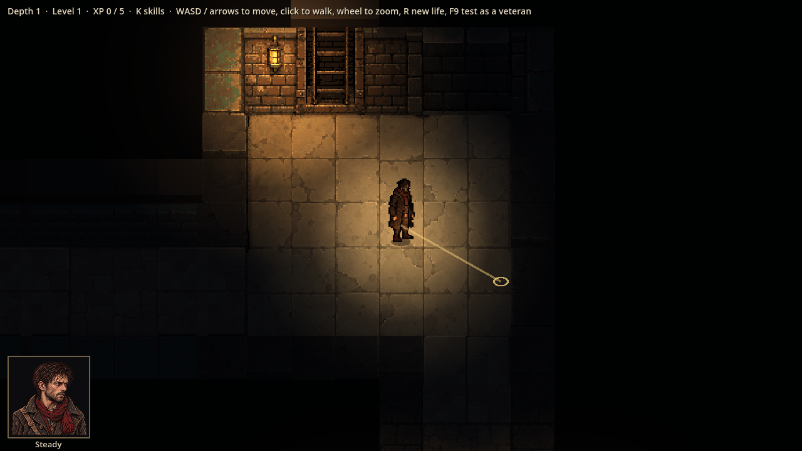
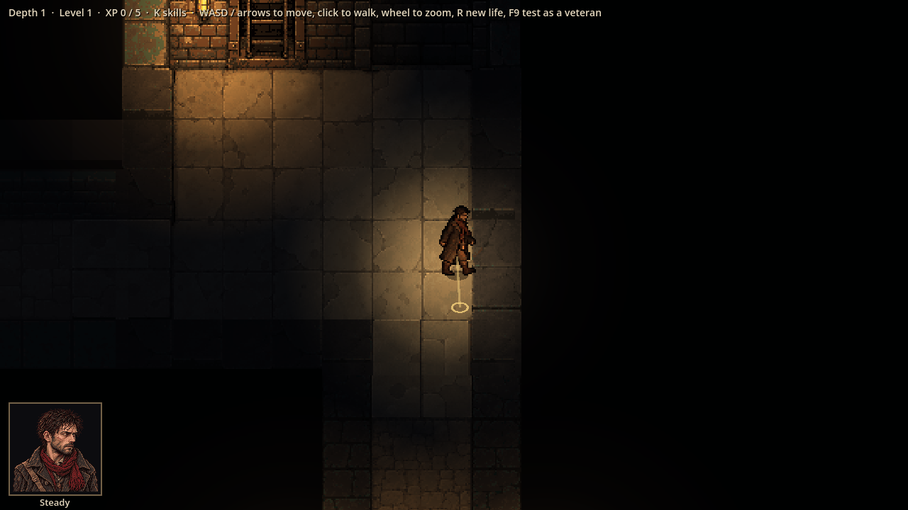

# Evidence: fights in metres (free movement, phase B) and grounded sprites

**Date**: 2026-10-30
**Spec**: `design/quick-specs/free-movement-2026-10-30.md` (phase B, Baldur's Gate 3 style); grounding from the same
playtest's notes.
**Engine**: Godot 4.7.2 (macOS, Compatibility renderer), windowed at 1280x720, life seed 7, depth 1.
**Run result**: OBSERVED — the real game driven by a capture script.

| Shot | What it shows |
|------|---------------|
|  | Thomas beside a wall lantern: his shadow falls away from it, onto the floor |
|  | Wading: his shins are under the water, with a ring of ripples at the waterline |
|  | His turn: the route to the mouse, bending round the wall, costing 7.0 m; his reach ring; the turn order along the top |
|  | After the click: he walked 7.1 m and stopped part-way across a square (at 1592, 1419; that square's middle is 1584, 1424). The HUD shows Move 0.4 m left; the preview past it is red |
|  | Exploring, after Julian's "the movement still locks to a grid": the route to the mouse is one straight line to the exact point, no square outline |
|  | After the click he stopped 2.6 px from the clicked point (857, 569), which is not a square's middle |

Also fixed after that playtest: the keys in a fight glide him smoothly (spending metres as he goes) instead of 1.5 m
hops, and enemies roaming outside fights walk straight lines between corners instead of square to square
(`test_the_patrol_walks_smooth_lines_not_square_to_square`, seen failing on square-to-square routes: 22 points for
22 squares). A click on a wall walks him up to it.

**Checks**: 121 tests pass. New fight tests: stopping anywhere, movement running out part-way (caught a bug in
cutting a route short, now fixed), routes round bodies, reach measured between bodies, clicking a far enemy walks up
and strikes, a fight starting where everyone stands. The old fight tests run unchanged where the rule is the same,
and with metres where it changed (Thomas has 7.5 m, a free strike as he leaves 3 m into his move leaves him 4.5 m,
wading costs double per metre waded, Garrick's sweep is a band 7.5 m wide).

**Not checked by these shots**: the normal-mapped lighting on the sprites is subtle at this scale and with these
sprites; ChatGPT's painted normal maps (art job 17) will show it properly. The sweep band, pushes along the line of
the blow and free-strike warnings are covered by tests, not shots. How it all feels needs a playtest.
