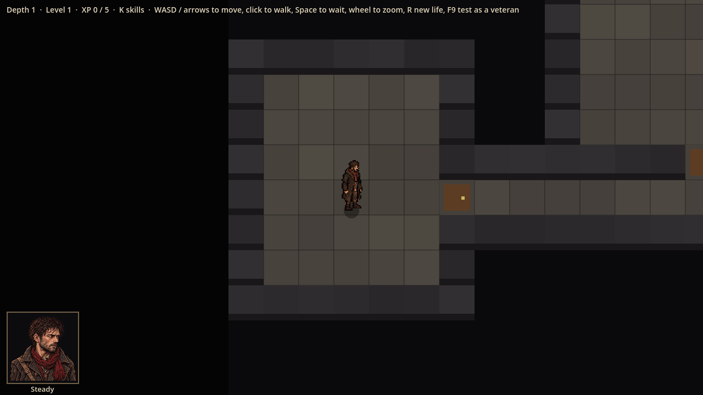
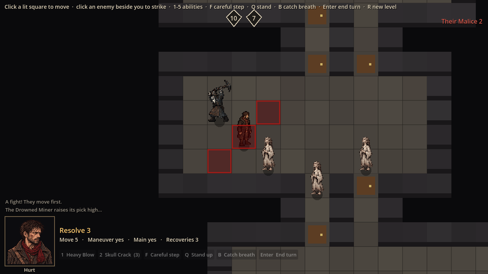
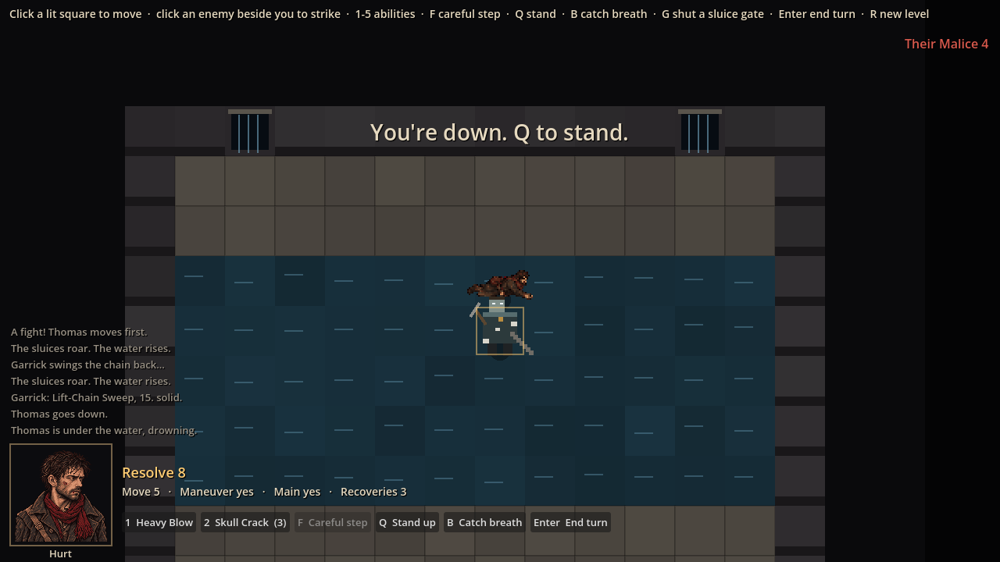
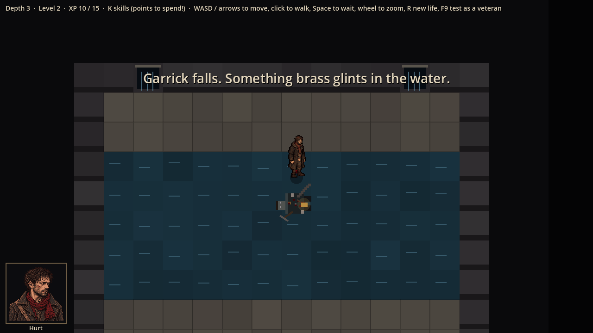

# Evidence: first-fight art in the game

**Date**: 2026-10-29
**Art**: approved by Julian and merged in #7 (with #14, #10, #12): Thomas's body sheet, his four health portraits, the Drowned Miner and Faithful sheets, hit and mace effects.
**Engine**: Godot 4.7.2 (macOS, Compatibility renderer)
**Run result**: OBSERVED — launched windowed at 1280x720; scripted captures.

| Shot | What it shows |
|------|---------------|
|  | Thomas's idle animation on the map; the steady portrait |
|  | A fight: the Drowned Miner winding up (wind-up row) with the darkened squares, three Faithful facing left (mirrored), Thomas, the hurt portrait |
|  | Thomas knocked down by Garrick's Sweep, lying in the water (first frame of his crawl, until the lying-down row arrives) |
|  | Garrick (still a drawn stand-in) dead, the tally tag, Thomas standing |

**Wired**: each character plays the row for what it is doing (idle, walk, wounded walk, hurt, attack, wind-up, dazed, pushed back, wall slam, prone, dying crawl, death, skull crushed), at the speeds in each README; sprites face left by a mirrored transform. The portrait switches between the four health states. Hits show the crushing flash (tier 3 the big one); slams show the wall-slam burst; dazed shows the ringing shimmer.

**Automated**: 76 tests pass; the art changes no rules.

**Not covered**: the hit, slam and dazed effects play for well under a second and are not in these stills. Thomas's mace attack sheets (#9), the blood decals (#13) and the dice (#15) are not merged yet, so his attacks use the body sheet and blood is still drawn.
