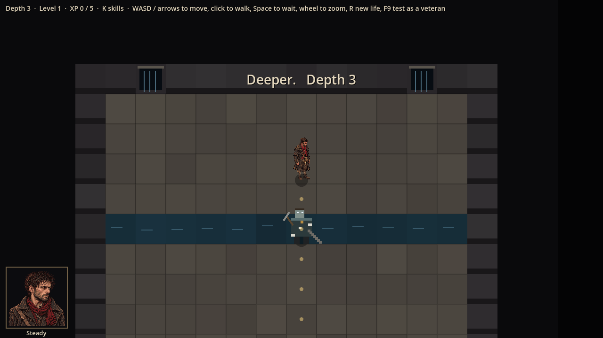
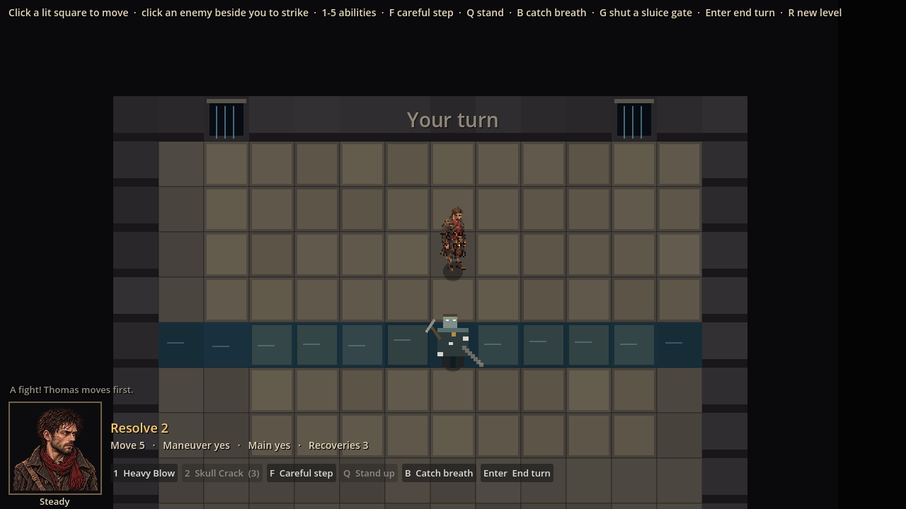
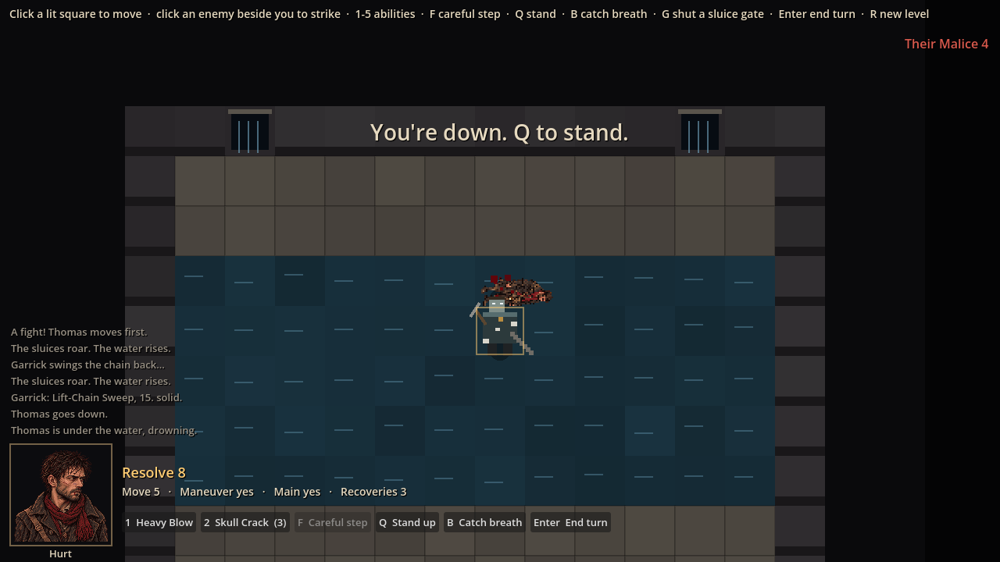
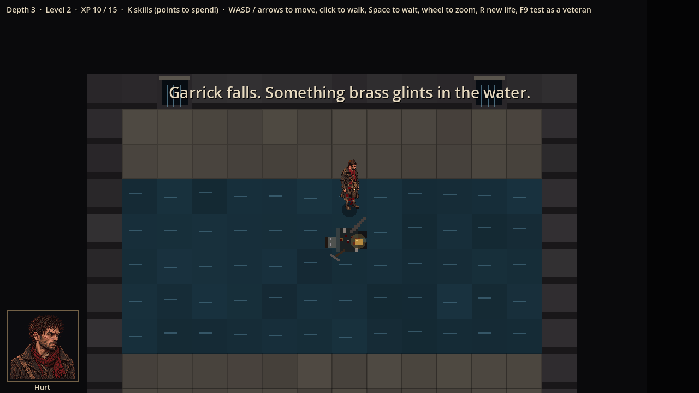
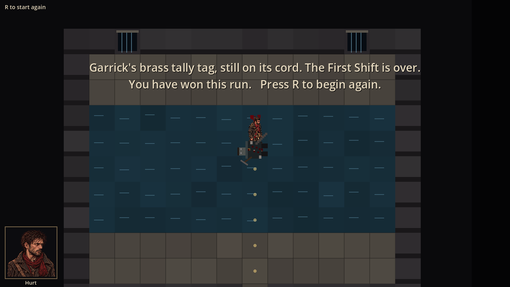

# Evidence: The First Shift (Sewers boss)

**Date**: 2026-10-29
**Spec**: `design/quick-specs/first-shift-boss-2026-10-29.md`
**Engine**: Godot 4.7.2 (macOS, Compatibility renderer)
**Run result**: OBSERVED — the game launched windowed at 1280x720 and played through a scripted boss fight. Staged: other enemies on the level were removed, Thomas was placed beside Garrick, and Garrick's Stamina was set to 1 before the last blow so the win could be reached in one run.

| Shot | What it shows |
|------|---------------|
|  | Depth 3: the Outflow with two open sluice gates (water pouring), the water channel, Garrick (stand-in drawing) |
|  | The fight starts; the HUD hint includes "G shut a sluice gate" |
|  | Two rounds in: the water has spread outward; the Lift-Chain Sweep knocked Thomas down in the water and he is drowning (log) |
|  | Garrick dead; the brass tally tag glints beside his body; banner "Garrick falls. Something brass glints in the water." |
|  | Thomas steps onto the tag: the win screen |

**Automated**: 76 tests pass (`tests/run_tests.gd`): 55 existing, 18 in `tests/test_first_shift.gd`, 3 in `tests/test_outflow_game.gd`.

**Not covered**: the feel criterion (a level-4 Thomas wins about half the time on a first try) needs a real playtest. Garrick, the gates and the tag are stand-in drawings until `ART_JOBS.md` jobs 11 and 12 arrive.

**Observed for tuning**: in this 12 × 9 room the water reaches about 55% of the floor after two rounds and about 77% after three, because the 60% cap is checked before each rise. That is fast; slow it with the water-rise knob if the playtest agrees.
