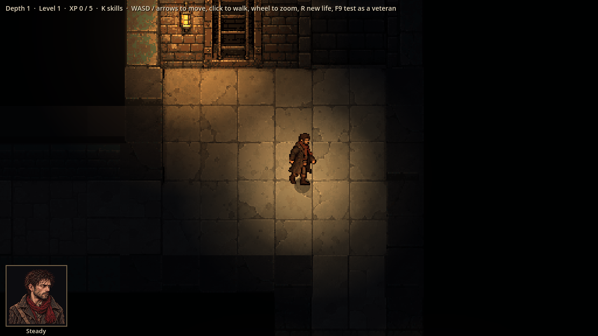
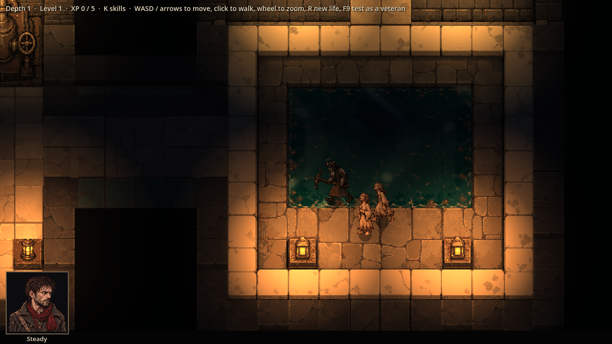
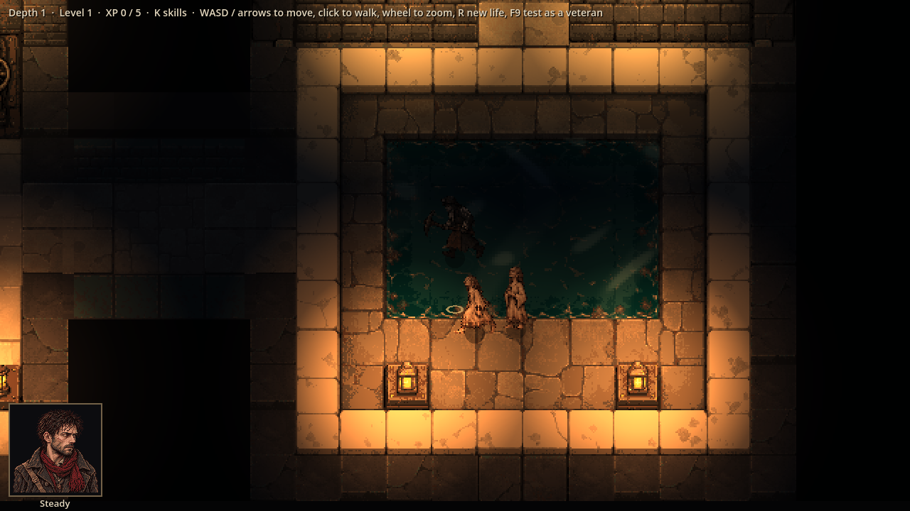
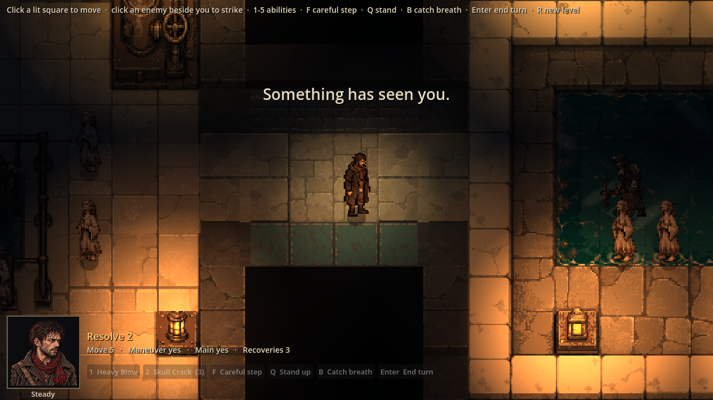

# Evidence: free movement, phase A

**Date**: 2026-10-30
**Spec**: `design/quick-specs/free-movement-2026-10-30.md` (phase A: exploring in real time, and the hit feel)
**Engine**: Godot 4.7.2 (macOS, Compatibility renderer), windowed at 1280x720, life seed 7, depth 1.
**Run result**: OBSERVED — the real game driven by a capture script (held keys, a clicked route, a patrol).

| Shot | What it shows |
|------|---------------|
|  | Thomas mid-walk on a diagonal, standing between squares (at 792, 536 px, not a square's middle) |
|  | The patrol in the flooded room, Thomas standing still elsewhere |
|  | About a second later: the patrol has walked on (37 px, 1.6 m/s) and left a ripple in the water |
|  | Walking up to a group: it sees him, the fight starts, and Thomas has slid onto a square |

**Checks**: 111 tests pass, including the new `test_movement.gd` (speed, speeding up and stopping, diagonals, wall
sliding, rounding a doorway corner, doors, water, click-to-walk, turn dust, snapping onto squares) and
`test_movement_rules.gd` (the maths on its own).

**Found while building**: the patrol used to join every fight on the level, wherever it was (anything not idle
counted as hunting Thomas). Now only hunters and searchers join from afar; regression test
`test_a_far_off_patrol_stays_out_of_someone_elses_fight`, seen failing on the old rule.

**Not shown by stills**: how it feels — the speed-up and stop, the hit-stop, wind-up and knockback. That needs a
playtest.
