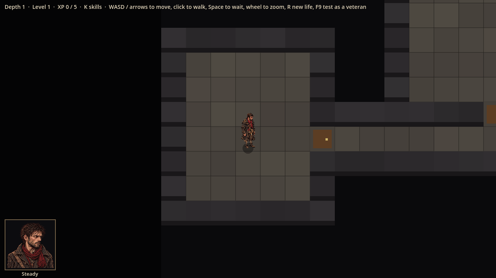
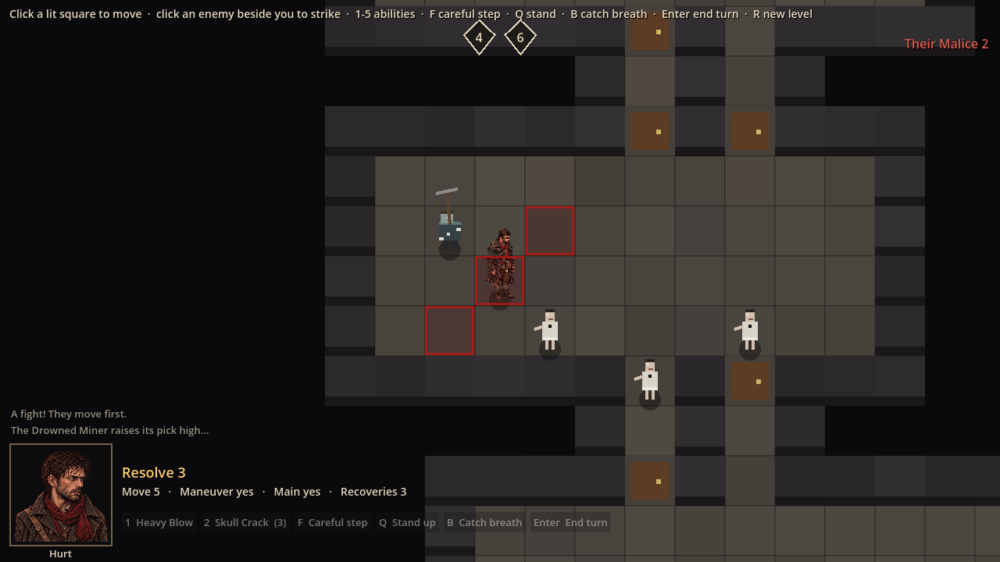
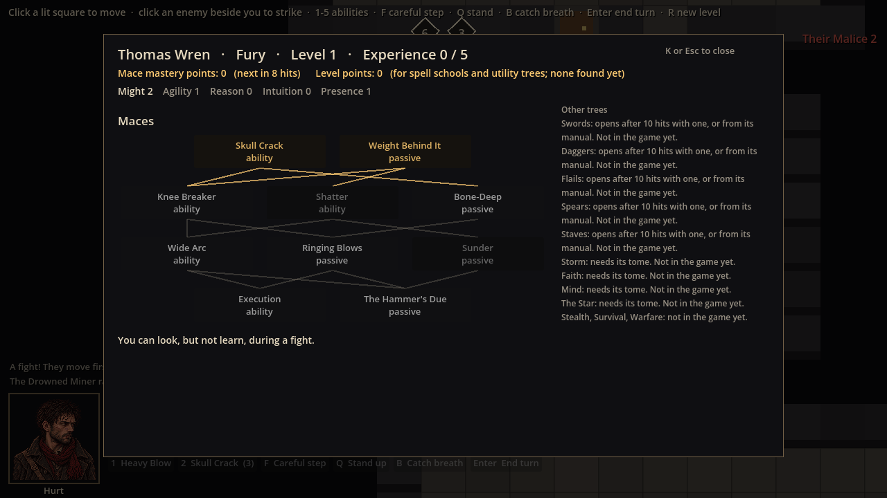

# Evidence: Godot 4.6 → 4.7.2 upgrade

**Date**: 2026-10-29
**Engine**: Godot 4.7.2.stable.official.ed1daf0bf (macOS, Compatibility renderer, Apple M4)
**Run result**: OBSERVED — launched windowed at 1280x720, three states captured.

Godot 4.7 adds no antialiasing feather to `CanvasItem` lines
(`docs/engine-reference/godot/VERSION.md` § Migration Notes). These shots check
that the game's drawn lines still read clearly.

| Shot | State | What it shows |
|------|-------|---------------|
|  | Exploring, depth 1 | Tile grid lines (`level_view.gd`), Thomas, portrait frame |
|  | Fight just started | Red target outlines (`overlay.gd`, width 1.5 → about 3 px at 2× zoom), miner's pick (`enemy_view.gd`), HUD |
|  | Skill tree open mid-fight | Link lines (`tree_screen.gd`, width 2.0 → 2 px) |

**Finding**: line widths, checked on enlarged crops, match the widths the code
asks for. The lines are solid with stepped (aliased) edges. Nothing reads as
too thin.

**Not covered**: no side-by-side with 4.6.2 (that would need the 4.6.2 build
downloaded). Gore lines (`gore.gd`) and the hurt/dying portrait states were not
on screen. Motion and feel are not covered by stills.
