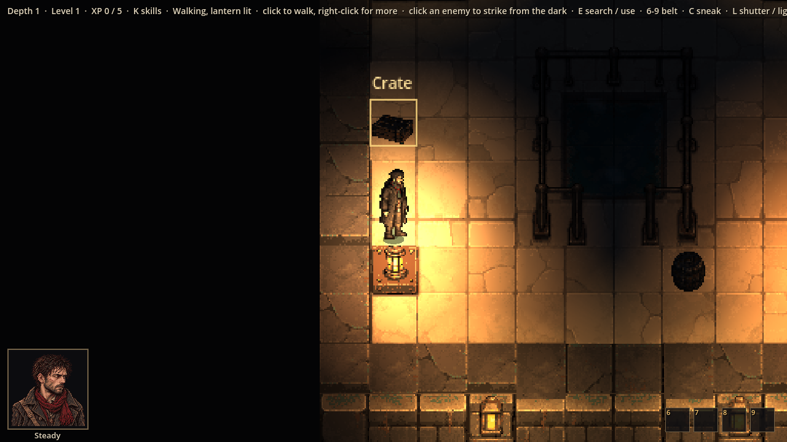
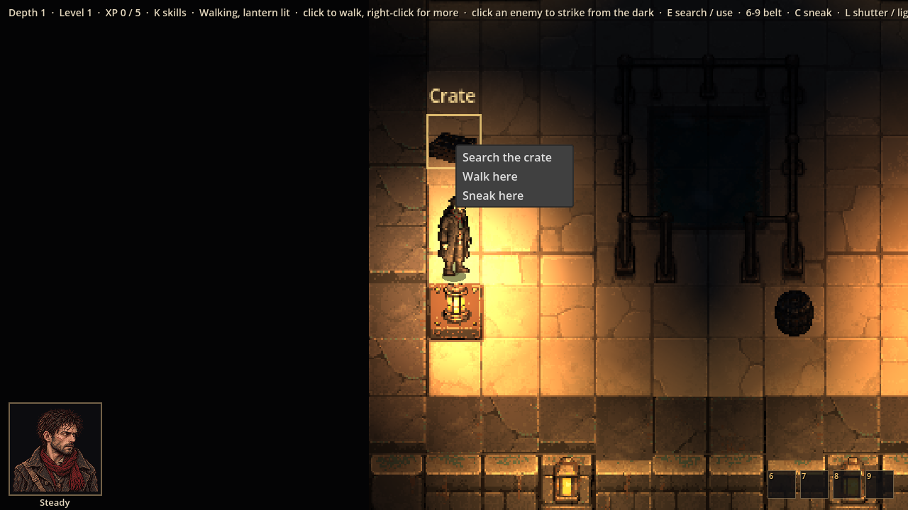
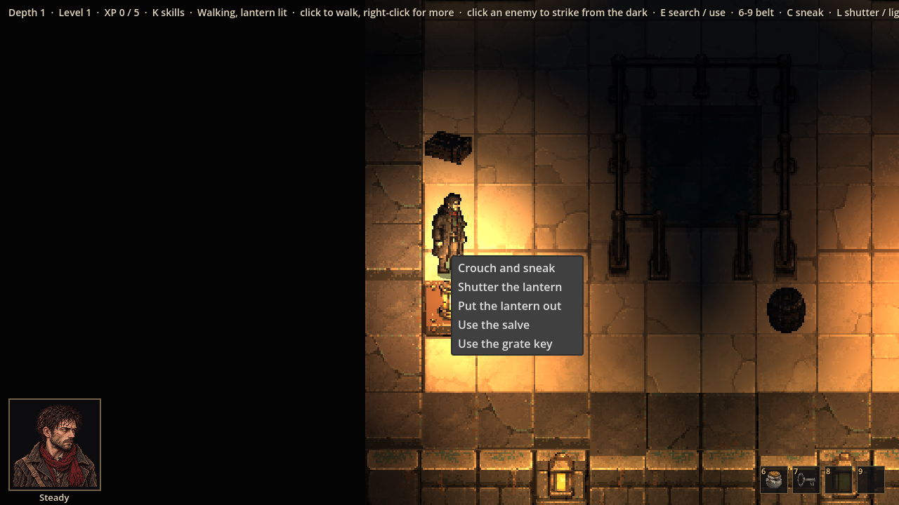
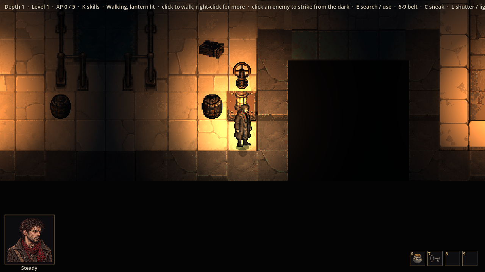

# Evidence: items, caches, puzzles, and mouse-first controls

**Date**: 2026-10-30
**Spec**: `design/quick-specs/room-contents-2026-10-30.md` (parts 3 and 4); controls as in Baldur's Gate 3 (Julian:
"make the game more mouse controls, like right click to open a context menu and then can select search").
**Engine**: Godot 4.7.2 (macOS, Compatibility renderer), windowed at 1280x720, life seed 7 (this level's puzzle is the
valve; enemies cleared for the shots).
**Run result**: OBSERVED — the real game driven by a capture script.

| Shot | What it shows |
|------|---------------|
|  | The mouse over a crate that can be searched: picked out, with its name |
|  | Right-click on it: Search the crate, Walk here, Sneak here |
|  | Right-click on Thomas: crouch, the lantern, the belt's items; the belt bottom right with ChatGPT's salve and key icons in slots 6 and 7 |
|  | The sluice valve on its standpipe (ChatGPT's art) beside a crate and barrels |

**Checks**: 170 tests pass, including `tests/test_items.gd` (over 60 seeds: caches on crates and barrels, one puzzle
per level, the exit always reachable with the grate shut, the key reachable without the key, something behind the
grate, the valve reachable; same seed same contents; searching, a full belt, salve and bandage in a fight, items used
up and lost on death, the grate opening only with its key, the valve draining its basin and revealing a satchel)
and `tests/test_controls.gd` (menus on Thomas, a crate, the floor, an enemy, and in a fight with greyed-out
abilities; left-click searching; clicking a belt slot).

**Not checked by these shots**: a grate level and draining over time (covered by tests); a playtest.
