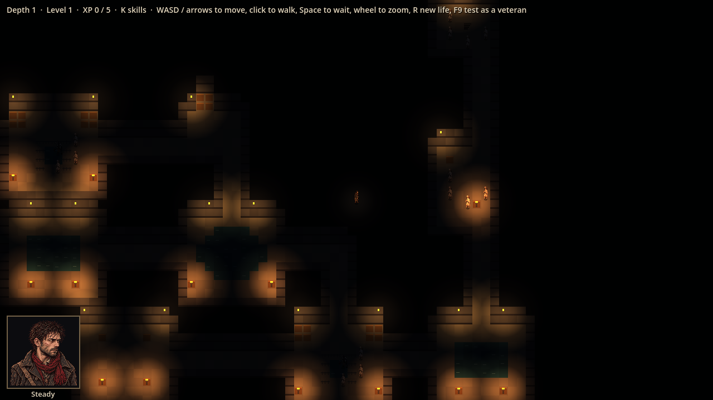
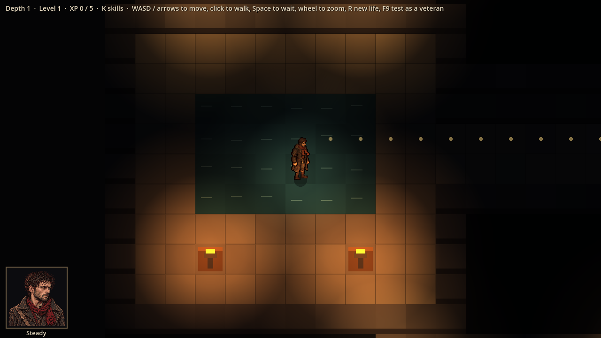
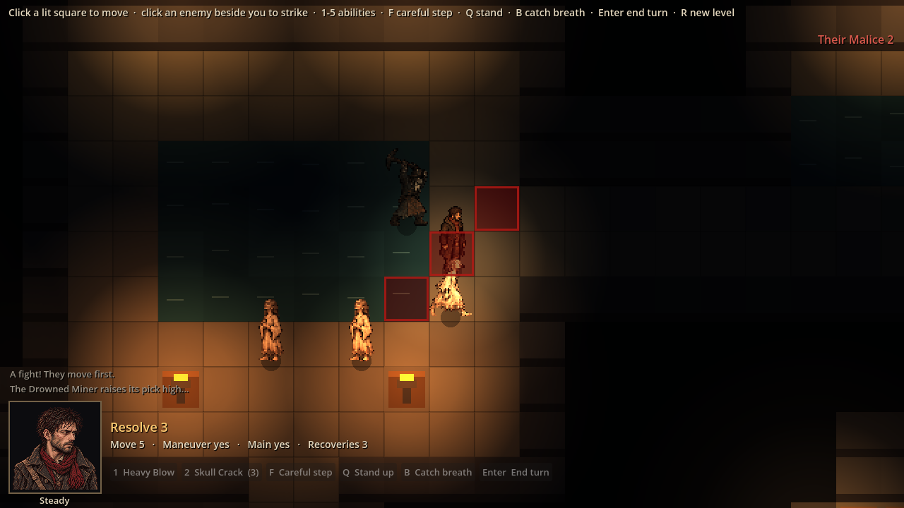
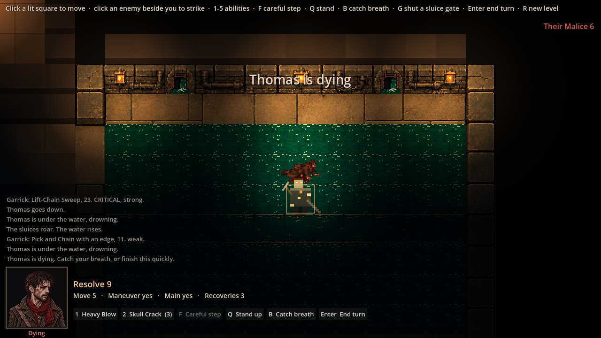

# Evidence: real lighting

**Date**: 2026-10-29
**Engine**: Godot 4.7.2 (macOS, Compatibility renderer, the web build's renderer)
**Run result**: OBSERVED — life seed 7 (depths 1 and 3), windowed at 1280x720.

| Shot | What it shows |
|------|---------------|
|  | A whole level zoomed out: every lantern and brazier lights its room; tunnels dark except Thomas's own lantern |
|  | A junction close up: braziers warming the floor and the pool |
|  | A fight: enemies lit by the braziers; the miner's wind-up squares and the HUD stay bright |
|  | The Outflow: its three painted lanterns lit at their glass, the rising water |

**Measured first:** on this renderer one drawn item is lit by at most 15 lights (24 lights over one item: 15 lit it). So the level and the blood are drawn in 8 x 8-square chunks; a test checks no chunk is reached by more than 15 lights over 120 levels.

**Automated**: 91 tests pass.

**For the playtest**: the dark is deep (ambient 0.08): enemies standing in unlit tunnels are hard to see until Thomas's lantern reaches them; `Lighting.AMBIENT` and `HERO_RADIUS` are the knobs.
