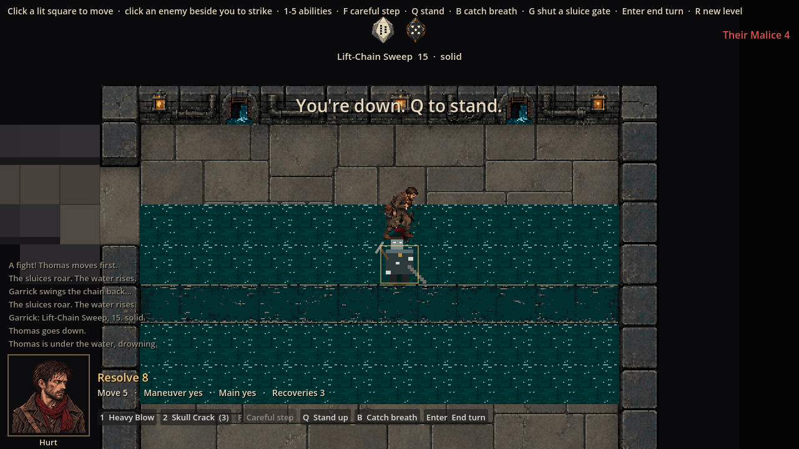
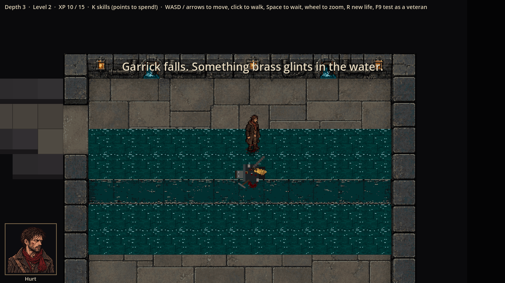
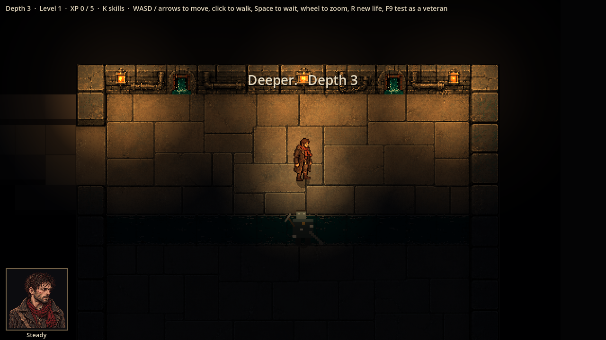
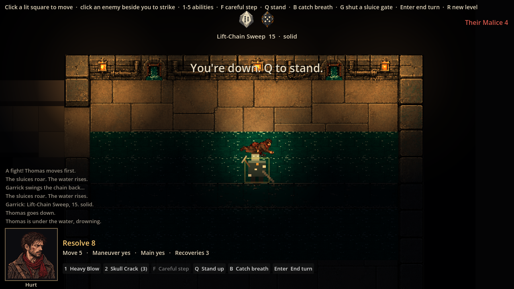

# Evidence: the painted Outflow in the game

**Date**: 2026-10-29
**Art**: ChatGPT's Outflow (#23), painted over `design/art-briefs/outflow/outflow-blockout.png`.
**Engine**: Godot 4.7.2 (macOS, Compatibility renderer)
**Run result**: OBSERVED — depth 3, the boss fight played through with fixed staging (other enemies removed).

| Shot | What it shows |
|------|---------------|
|  | The painting in place, with ChatGPT's open sluices, flooded squares and Garrick; no game lighting |
|  | Garrick dead; ChatGPT's tally tag beside his body |
|  | **Temporary lighting** (the prototype's darkness, and lights at the three glass centres from the README) |
|  | The same lighting with the room flooding and Thomas knocked down |

The lit shots add the lighting inside the capture script only; the lighting itself is still the prototype on `prototype-sewer-lighting`.

**Checks**: 448 × 352, at most 32 colours, hard edges; walls, entrance, gate arches, channel and lantern fixtures land on the blockout's squares in the game; 77 tests pass.

**Compared with the concept art** (`assets/reference/saltmarrow-deep/biomes/rotwater-sewers.png`): the mood comes through once lit (warm pools on wet stone, darkness, teal water). Still short of it: walls are one square tall, the room is a plain rectangle with no walkways, railings or machinery, the south half has no light, and the flooded tile repeats visibly.
