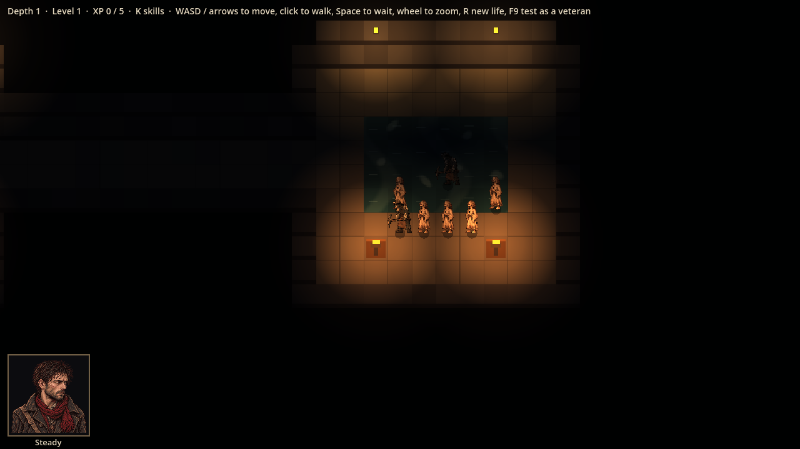
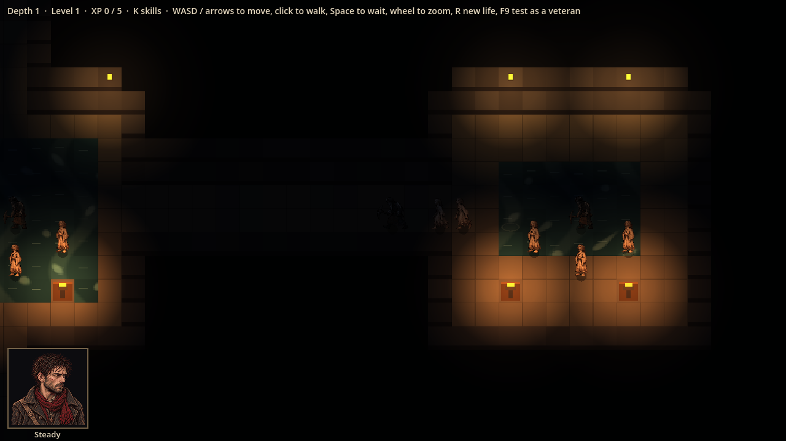

# Evidence: room contents part 1 (enemies and the patrol)

**Date**: 2026-10-30
**Spec**: `design/quick-specs/room-contents-2026-10-30.md`, part 1
**Engine**: Godot 4.7.2 (macOS, Compatibility renderer)
**Run result**: OBSERVED — life seed 201, the camera on the patrol's leader; six patrol steps between the shots.

| Shot | What it shows |
|------|---------------|
|  | The patrol (a Drowned Miner and two Faithful) starting in a flooded room beside that room's own waiting group |
|  | Six turns later: the patrol walking the dark tunnel west toward its next room (route: two rooms, back and forth) |

**Measured** over 60 lives: groups in 70% of junctions and chambers and 78% of flooded rooms (target 75%). Before the fix in this change, flooded rooms had groups only 44% of the time: Faithful-only groups were placed on dry floor only, and a flooded room's middle is water.

**Automated**: 99 tests pass (`tests/test_room_contents.gd`: share of rooms with groups, one patrol per level with a 2-4 room route never stopping in the entry, the leader walking its route and turning back, followers keeping up, the patrol spotting Thomas).

**Seen in the shots**: the patrol is hard to see in an unlit tunnel, the same point as the playtest's darkness note.
