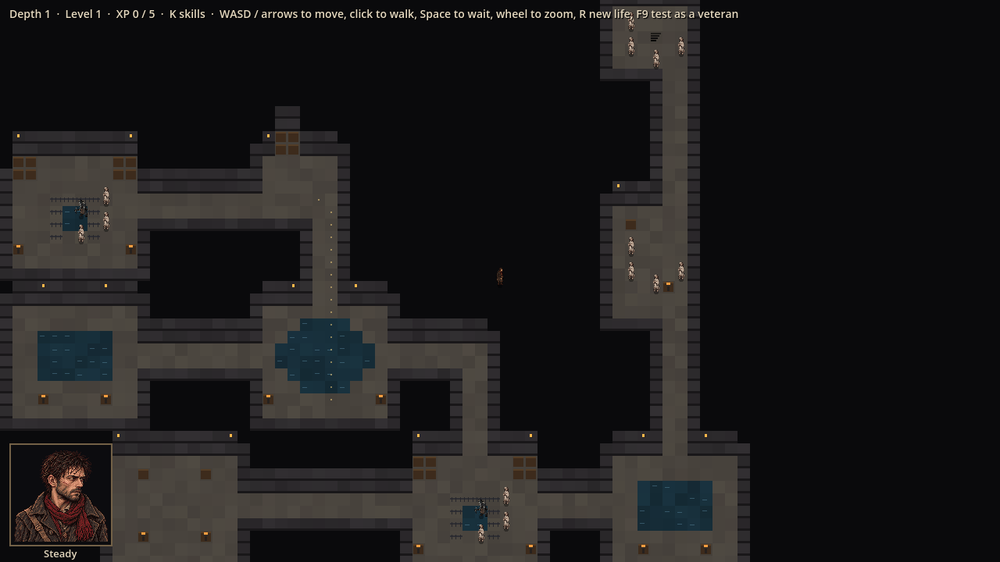
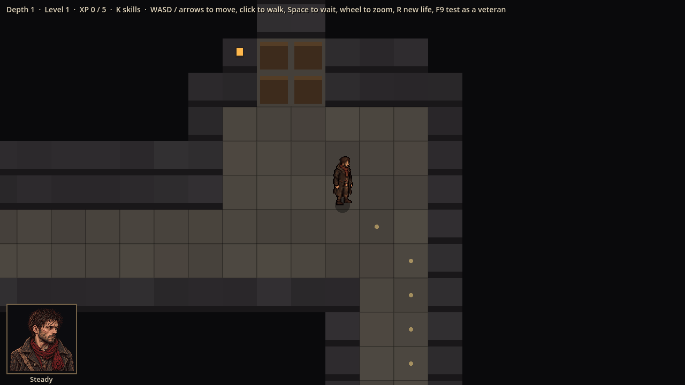
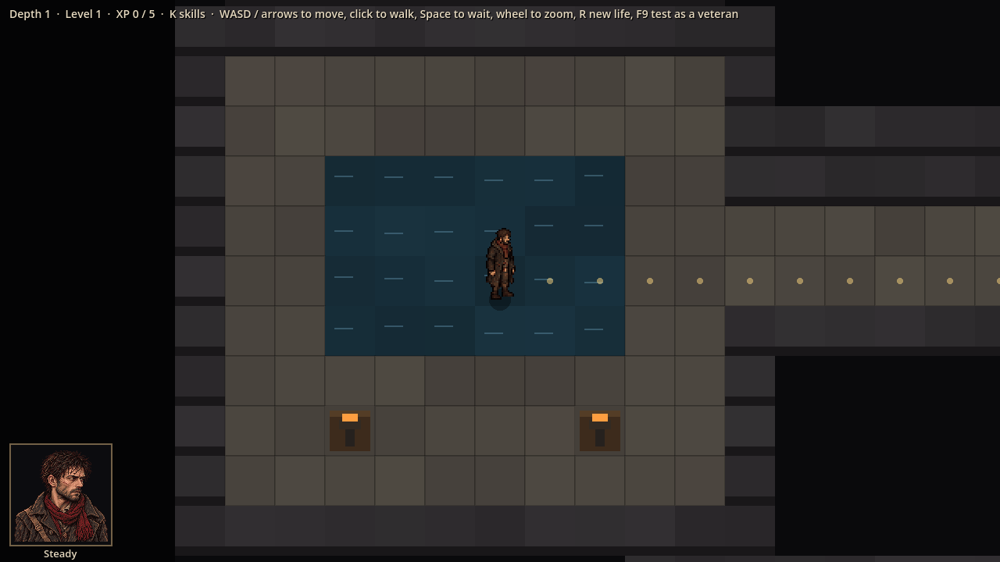
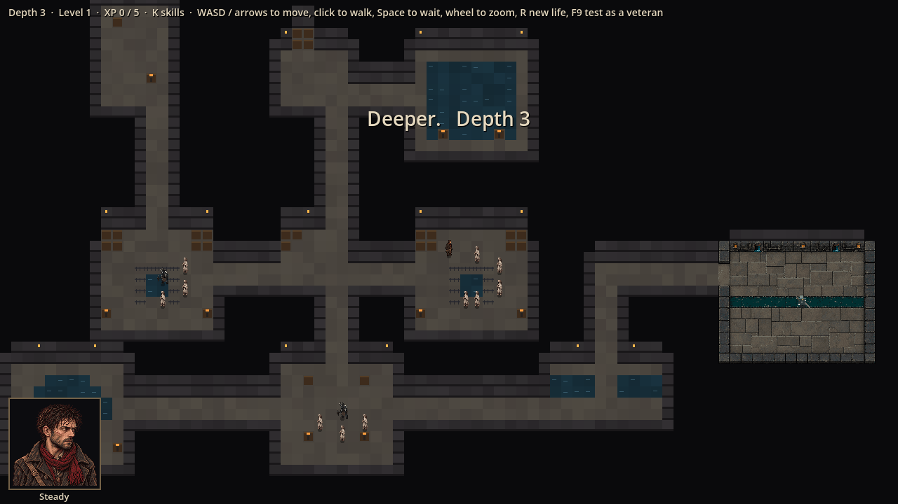

# Evidence: the Sewers room kit, with stand-in drawings

**Date**: 2026-10-29
**Spec**: `design/quick-specs/sewer-room-kit-2026-10-29.md` · blockout standard `design/art-briefs/README.md`
**Engine**: Godot 4.7.2 (macOS, Compatibility renderer)
**Run result**: OBSERVED — life seed 7, depth 1 and depth 3, windowed at 1280x720.

| Shot | What it shows |
|------|---------------|
|  | A whole depth-1 level zoomed out: rooms joined by 2-square tunnels; junctions with pillars, railed pits and braziers; flooded rooms; enemy groups away from the start; the stairs room |
|  | The entry room close up: the ladder fixture in the two-square-thick north wall, doors west and south |
|  | A junction close up: pool, braziers |
|  | Depth 3: the Outflow (ChatGPT's painting) at the end of the longest branch |

Rooms and tunnels are stand-in drawings; each layout shows ChatGPT's painting once `assets/tiles/sewers/rooms/<layout>/1.png` exists. Raised walkways look like floor until painted.

**Automated**: 86 tests pass, including 300 generated levels (reachable, every room matching its blockout, exit at the end of the longest branch, at most one lore room) and same seed twice giving the same level.
