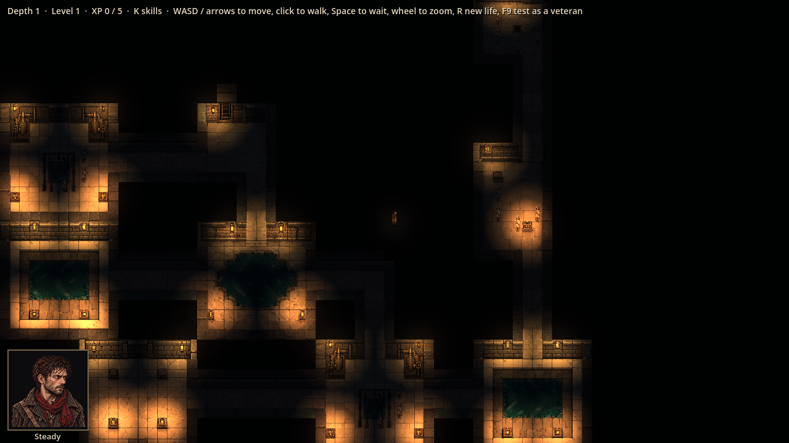
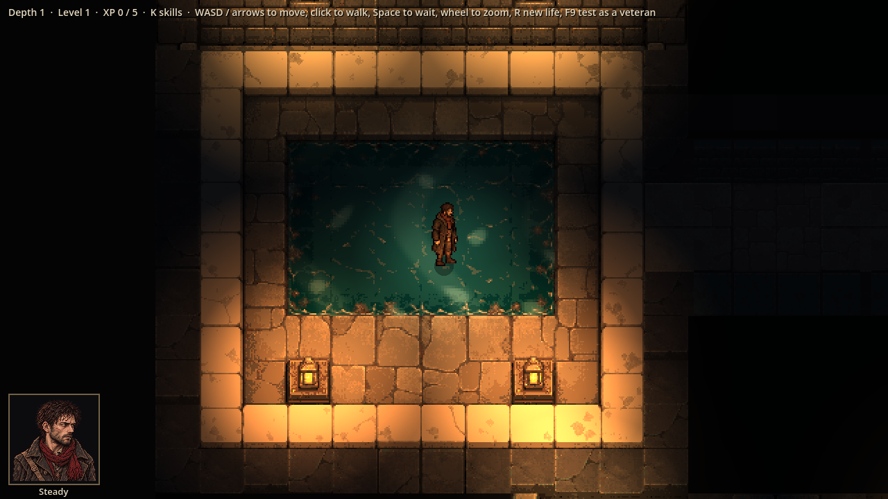
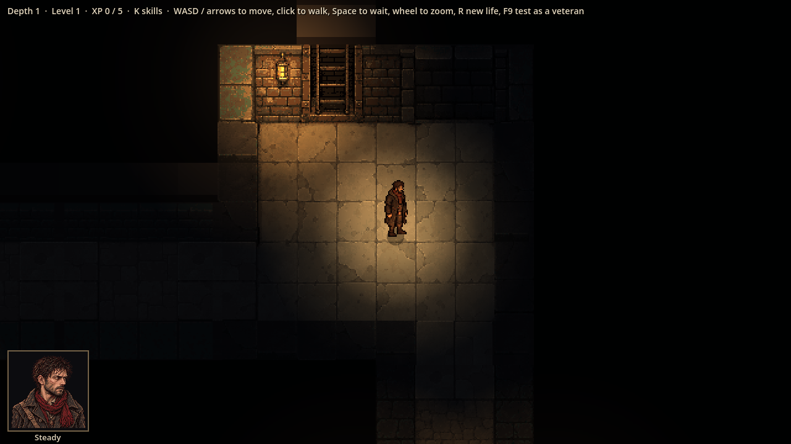
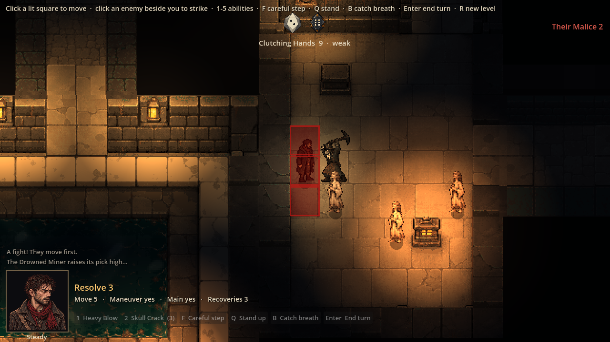

# Evidence: ChatGPT's Sewers room kit, first batch (#32), in the game

**Date**: 2026-10-30
**Art**: `assets/tiles/sewers/rooms/` — 12 rooms, 6 tunnels, 4 sealed-doorway pieces (job 13).
**Engine**: Godot 4.7.2 (macOS, Compatibility renderer), with the real lighting and moving water.
**Run result**: OBSERVED — life seed 7, depth 1, windowed at 1280x720.

| Shot | What it shows |
|------|---------------|
|  | A whole level zoomed out, every room and tunnel painted and lit |
|  | The settling tank close up: raised walk, pool with the shimmer, braziers |
|  | The entry: the ladder up to town in the north wall, its lantern |
|  | A fight in a painted room: Faithful and the miner lit by braziers, a painted crate |

**Checks**: every painting is exactly its blockout's size; the game draws them at their blockouts with sealed pieces over unused doorways; 94 tests pass. ChatGPT's own checks (`validation.json`): one shared palette of at most 32 colours, binary alpha, walkable and water squares, clear doorways, 450 tunnel-edge comparisons.

**Found**:
- Art: a teal-green square in some north-wall corners (the entry's top-left; similar in the stairs and lore rooms), probably left from the blockout's door colour. The junction "pillars" read as low pedestals rather than pillars.
- Code: the game lights each lantern at the middle of its blockout square; ChatGPT's READMEs give the exact painted glass positions (31 fixtures). Using those would put the light exactly on the glass.
