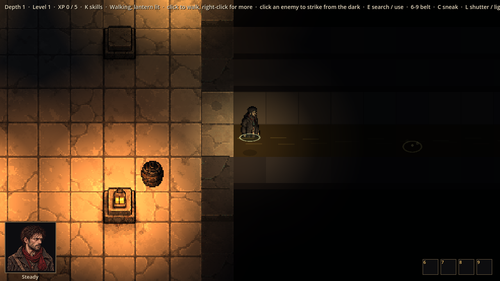
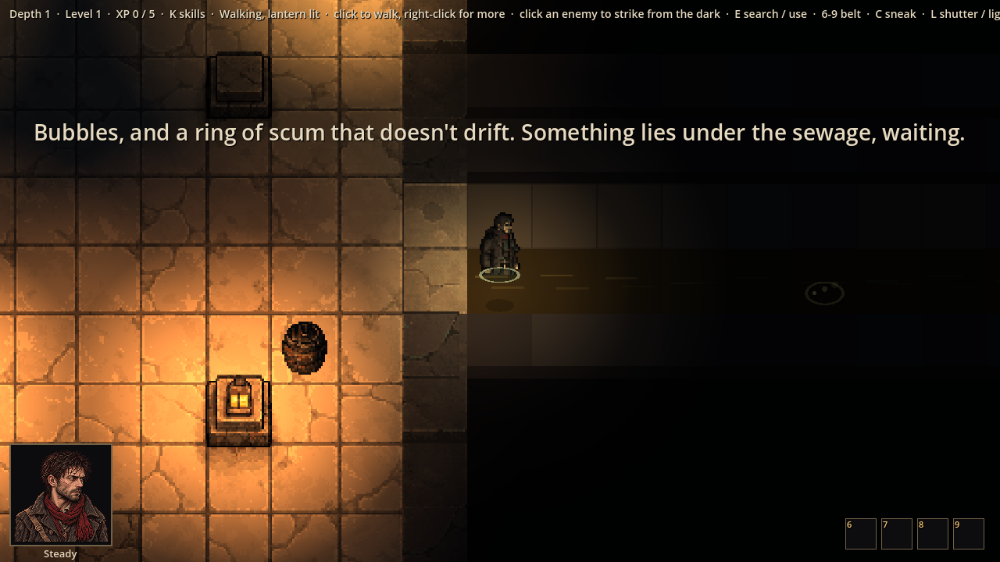

# Evidence: deep sewage tunnels and lurkers

**Date**: 2026-10-30
**Spec**: `design/quick-specs/deep-sewage-tunnels-2026-10-30.md` (approved first set: lurkers with their tell, drag
under, the ledge).
**Engine**: Godot 4.7.2 (macOS, Compatibility renderer), windowed at 1280x720, life seed 1 (other enemies cleared).
**Run result**: OBSERVED — the real game driven by a capture script.

| Shot | What it shows |
|------|---------------|
|  | Thomas in a sewage tunnel, drawn cut off at the waist with a ring at the waterline; the tunnel as a stand-in (brown sewage, scum lines) until art job 18; further along, a lurker's tell on the surface (a faint still ring) |
|  | Spotting a lurker: the banner ("Something lies under the sewage, waiting.") |

**Checks**: 179 tests pass, including `tests/test_sewage.gd` (tunnels in a third or more of levels, 12-20 squares of
deep sewage; most tunnels hide one lurker, unseen, in the sewage; wading at 40 %, 3 m per metre in a fight, twice as
loud, waist-deep; drowning; being knocked off a ledge; a lurker doesn't watch; creeping close spots it and lets
Thomas strike first; walking onto an unseen one, it moves first with an edge; Drag Under pulls him down).

**Found while building**: loops could turn a sewage block into a junction piece, breaking the tunnel; the lurker's
place was worked out across the tunnel as well as along it, so none were placed; a patrol follower could stick
inside another group's members (they now walk apart, and a stragglers hurries).
