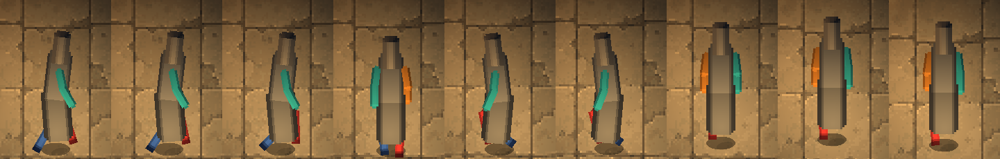

# Evidence: the skeleton (characters as parts)

**Date**: 2026-10-30
**Why**: ChatGPT's frame-by-frame camera test (#47) flickered: each painted frame was a slightly different Thomas.
Julian: "can it somehow follow a template or a skeleton you can design for the animations?"

| Proof | What it shows |
|------|---------------|
| `../rig-proof/walk_compare.html` | ChatGPT's own south frame, cut by hand into six parts and moved by the walk, beside its 8 painted frames: the same drawing every frame, no flicker |
|  | The real rig in the running game (Godot 4.7.2, Compatibility renderer, life seed 7), with stand-in parts: walking east (two moments), south, west (east mirrored), north, and standing. The near arm in front of the body and the far arm behind it; the legs under the coat; lit by the room's lanterns |

**Built**: `scripts/game/rig_pose.gd` (the walk, standing, sneaking and the limp in 3D, and the rooms' camera; the
pose guides now use it too), `scripts/game/rig.gd` (the parts-sheet layout and where each part goes and turns),
ActorView drawing a rigged character for its moving animations (attacks and the like stay painted), Thomas loading
`assets/characters/thomas/rig/` when ChatGPT delivers it (until then nothing changes), and `tools/rig/rig_template.gd`
(templates, assembled and walking stand-ins for every direction, in `design/art-briefs/animation/rig/`).

**Checks**: 189 tests pass, including `tests/test_rig.gd` (10 tests: the legs alternate and plant, sneaking and the
limp, parts at their joints and turned with their bones, the coat over the legs and the near arm over the body, the
right direction picked and the west mirrored, only the moving animations rigged, wading hiding parts, no rig until
the art arrives).
