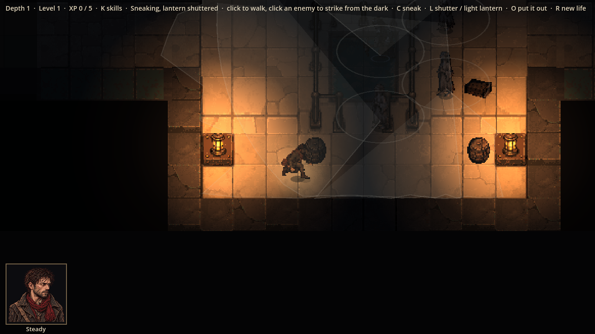
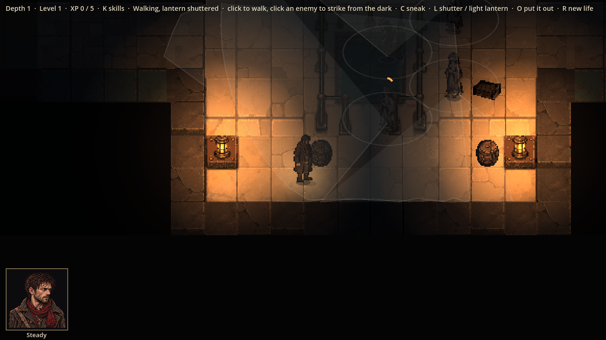

# Evidence: cover, and levels built for sneaking

**Date**: 2026-10-30
**Spec**: `design/quick-specs/sneaking-2026-10-30.md`, "Cover, and levels built for sneaking" (Julian: "vision
should be obscured by objects... the world should generate with viable ways to sneak around enemies and set up
ambushes").
**Engine**: Godot 4.7.2 (macOS, Compatibility renderer), windowed at 1280x720, life seed 7, depth 1.
**Run result**: OBSERVED — the real game driven by a capture script. This level: 3 loops, 28 crates and barrels.

| Shot | What it shows |
|------|---------------|
|  | Thomas crouched behind a barrel (ChatGPT's job 14 art), lantern shuttered, a Faithful looking straight at him through the railing: not seen, its meter at 0. The barrel is drawn among the creatures, so it stands in front of or behind them by where their feet are |
|  | He stands up in the same spot: seen, the meter starts to fill |

**Built**
- **Crates and barrels** (a new COVER square): block walking, not sight. Crouched within 1.5 m behind one, with it
  between him and the enemy, Thomas is hidden (unless it is within 2 m, where it notices anything).
- **Water**: crouched in water the meter takes 1.4 × as long to fill (and wading is still twice as loud).
- **Pillars and machinery** already blocked sight; the cones stop at them.
- **Loops**: the generator joins a room's free doorway by a straight run of 1–5 tunnel blocks to another room's
  doorway facing it, or to a tunnel already there (which becomes a T or crossroads), up to 3 per level.
- **Cover in rooms**: 2–4 crates and barrels in each room a band can wait in, first a few squares in from each open
  doorway (a covered way in), then against the walls. Doorways and the middle of the room (where a band waits and a
  patrol aims) stay clear, and every walkable square stays reachable (checked as each one is placed).
- Roaming enemies now find a way round anyone standing in their way, instead of waiting for them to move.

**Checks**: 144 tests pass, including `tests/test_sneak_cover.gd`: a crate hides him only crouched, close and in
line; crates block walking but not sight; crouching in water slows the meter; over 40 seeds every level has cover,
every room middle is clear, at least 60 % of levels have a loop, at least 90 % of band rooms have cover; the same
seed gives the same cover and loops. The room kit test now counts a crate square as the blockout's floor.

**Not yet**: patrol routes are not steered past cover on purpose (they pass through rooms that have it); a playtest
will say whether ambushing the patrol needs more.
