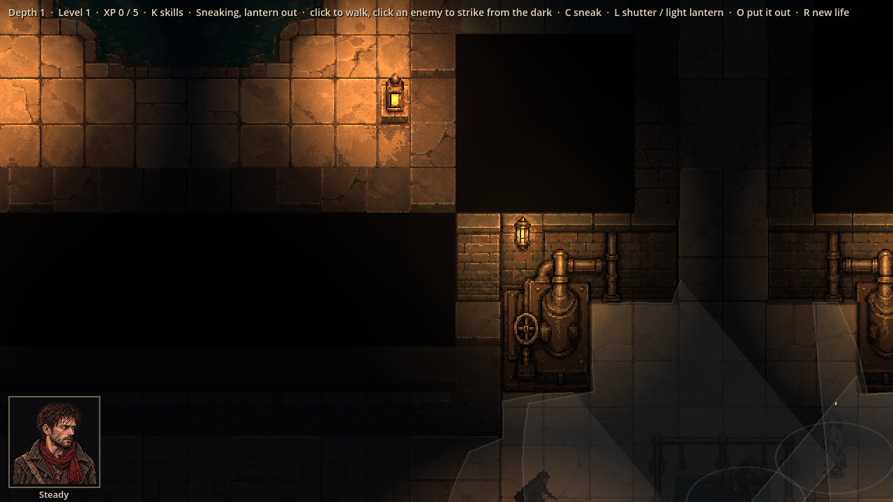
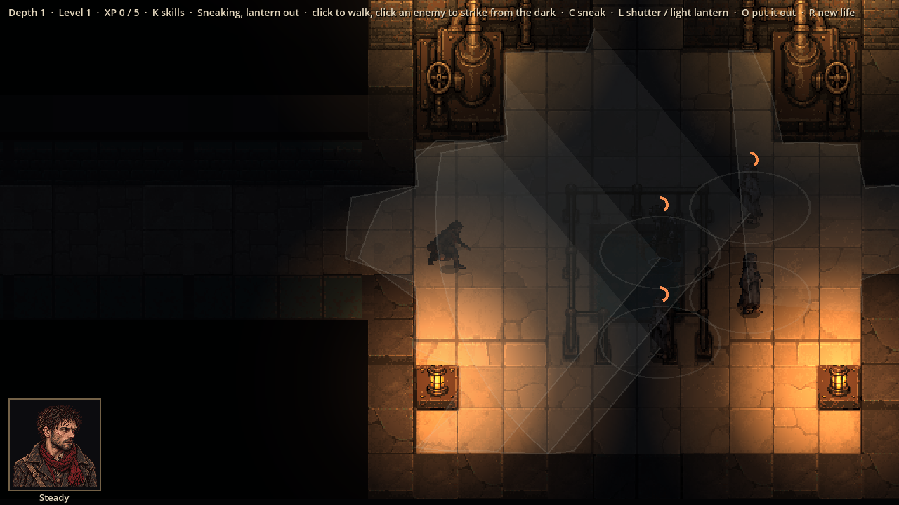

# Evidence: sneaking, part 1

**Date**: 2026-10-30
**Spec**: `design/quick-specs/sneaking-2026-10-30.md` (approved by Julian 2026-10-30). Part 1: sneaking, the
lantern, view cones, the spotting meter, noise, suspicious enemies, striking from the dark. Parts 2 (choosing a
backstory, Shadow, Daggers) and 3 (hiding mid-fight, preparations) follow.
**Engine**: Godot 4.7.2 (macOS, Compatibility renderer), windowed at 1280x720, life seed 7, depth 1.
**Run result**: OBSERVED — the real game driven by a capture script.

| Shot | What it shows |
|------|---------------|
|  | Thomas crouched with his lantern out (the HUD: "Sneaking, lantern out"); the enemies' view cones on the floor, cut short by walls, each with its small all-round circle |
|  | Creeping in front of a band: three of them see him and their meters fill over their heads (orange arcs). In the dark and crouched it is slow: after 2 s the nearest is at 40 % |

**Checks**: 139 tests pass, including `test_stealth.gd`: the cone and all-round circle, the meter filling slower far
off, dark and sneaking (and the dark-and-sneaking case taking over 2.5 × as long in the game), his lantern and the
room lamps lighting him, footsteps and walls muffling them, a suspicious enemy going to look and settling again,
creeping up unheard while walking is heard, the lantern shuttering, going out and taking 2 s to relight standing
still, striking from the dark giving a surprise round (the log says so; the first blow has an edge), and surprised
enemies giving no free strike until the round ends.

**Found while building**: striking an enemy from the dark started a fight with no one in it (nobody had seen him);
the struck enemy's band now always joins.

**Not checked by these shots**: how fast spotting feels, and whether noise is too touchy; that needs a playtest.
