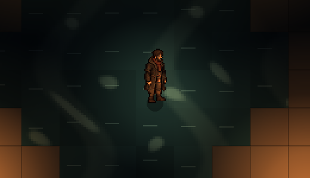
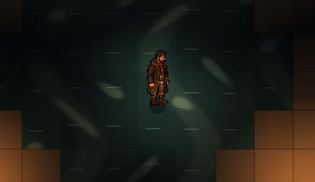
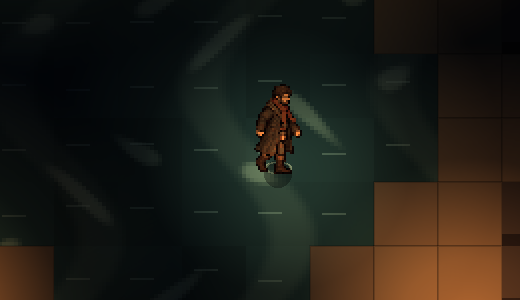

# Evidence: moving water

**Date**: 2026-10-29
**Engine**: Godot 4.7.2 (macOS, Compatibility renderer, the web build's renderer)
**Run result**: OBSERVED — life seed 7, Thomas standing in a flooded room, windowed at 1280x720 (crops of the middle).

| Shot | What it shows |
|------|---------------|
|  | The shimmer: soft ripple bands and glints over the water, lit by Thomas's lantern |
|  | 0.7 seconds later: the bands and glints have moved |
|  | Thomas wading one square: a ring starting at his feet |

**How**: `scripts/game/canvas_env_water.gdshader` draws over every water square, per level chunk (so the 15-light limit still holds); it sits on top of stand-in and painted water alike. `scripts/game/ripple.gd`: a ring when anyone steps into water, a splash (two rings and drops) when anyone goes down in it.

**Automated**: 94 tests pass (`tests/test_water.gd`: every water square shimmers, wading makes a ripple and stepping onto dry floor doesn't, going down in water splashes).

**Not covered**: stills can't show the motion's feel; flow direction along channels isn't modelled (the water drifts, it doesn't run).
